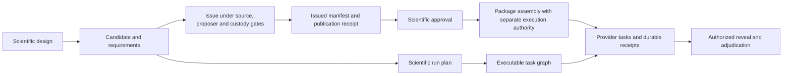

# Architecture

SPDX-License-Identifier: CC-BY-4.0

This guide maps the implemented scientific engine to its source owners.
It locates validation, planning, execution and custody within the researcher workflow.
Use it to find an interface, implementation owner and relevant checks.

The scientific object is the support-limited response relation `L(D,H,A,R,τ)`.
Its operands are the prepared denominator, causally available history, native action chart, receiver and horizon.
The shared engine owns their contracts.
Substrate adapters provide native preparation, delivery and observation.

## Source layers

```text
kernel <- planning <- runtime <- adapters and infrastructure <- API <- CLI
```

Imports point toward the scientific core.
Adapters and infrastructure can compose at their shared layer.
Neither layer imports the API or CLI.
The CLI example entry can import its example implementation.
Other production modules use the native resource owner directly.
The [import-boundary check](../../tests/test_import_boundaries.py) includes local and relative imports.

| Owner | Responsibility |
|---|---|
| [Kernel](../../src/empirical_lawhood/kernel/) | Scientific records, native units, support, visibility, validation and canonical identities |
| [Planning](../../src/empirical_lawhood/planning/) | Design lineage, independent units, prospective cutoffs, authority obligations and source profiles |
| [Runtime](../../src/empirical_lawhood/runtime/) | Registries, candidate/plan compilation, provider protocols, scientific services and recovery contracts |
| [Adapters](../../src/empirical_lawhood/adapters/) | Native sources, scientific methods, controller bridges and family composition |
| [Infrastructure](../../src/empirical_lawhood/infrastructure/) | Bounded I/O, guarded custody, signatures, receipts, local scheduling, source verification and SQLite projection |
| [API](../../src/empirical_lawhood/api/) and [CLI](../../src/empirical_lawhood/cli/) | Application composition, strict document handoffs and the single installed command |

## Records, lineage and three graphs

Frozen records declare their schema and format revision. Their constructor checks own scientific operands and support limits. [Canonical serialization](../../src/empirical_lawhood/kernel/serialization.py) binds exact bytes to identity. [Strict decoding](../../src/empirical_lawhood/kernel/decoding.py) rejects invalid shapes, unknown fields and identity substitutions at its declared boundary.

Shared record validation belongs in the kernel. Bounded descriptor reads belong in [infrastructure](../../src/empirical_lawhood/infrastructure/bounded_io.py). Family-specific scientific helpers remain with their adapter owner.

Large immutable canonical records share encoded child fragments instead of
retaining a complete byte copy at every ancestor. Materialization and hashing
preserve the exact canonical representation; mutable mappings remain uncached.
Exact size and byte comparison use those fragments without another full copy.
Encoding does not compute unused descendant fingerprints. Each requested
fingerprint hashes its exact canonical bytes, including the final newline.
Only deeply immutable records retain encoded fragments or fingerprints.
Task configuration validation uses the C JSON decoder and compares the complete
canonical re-encoding. This still rejects duplicate keys, binary floats and
noncanonical spellings. A requested response implementation constructs its
own current declaration without rebuilding unrelated response phases.
Runtime registries index their closed factory census, and sorted task rosters
use indexed selection without adding fields to scientific records.
Dependency indices preserve ready-task ordering and release scheduler work
only after the controller acknowledges a durable outcome.
The coordinator admits each prepared task before preparing another ready task.
It checks owned leases and dispatch refusal between preparations. Bounded verification
queues refill when any check completes. Per-item access checks retain current
grants; publication and read completion retain complete byte verification.
Pure continuation projections refresh access within their owning read scope.
They do not repeat whole-history verification. Composite checkpoints verify each
shared live byte census once; separate and custom custody scopes remain separate.
The stock read context owns one complete final check, including consumer refusal.
Programme predecessor readers propagate that scoped service through the complete
continuation chain. Shared publications retain one byte proof within the read.
Each predecessor still checks its selected records and current access.
Execution uses its separate ordinary context.
Source continuation checks current source bytes before and after its closed
metadata publication group, including partial failure. Its final continuation
seal retains a separate current-source check. Each write retains its ordinary
resource, immutable publication and copied-input checks.
New phase input records form one bounded closed publication, with current
custody checked after constructing the complete group and again on return.
Existing single-record publications and custom write hooks retain their original boundaries.
Recursive configuration and run-input metadata use groups of at most 64 members and 4 MiB.
Smaller selected custody limits split these groups before publication. Binary and large inputs retain their individual stream boundaries.
Existing members keep their original closed publications, and interrupted matching groups use the ordinary intent recovery.
Input copies share one finite source-read scope. Complete source bytes and current access are checked before admission or dispatch.
Each recursive payload reader shares one callback identity within its live custody scope.
Repeated reads invoke that callback freshly without accumulating duplicate registrations.
A changed callback or a separate reader retains its distinct guard.
Selected bodies, publication siblings and final byte checks retain their current access boundaries.
Current task preparation resolves full and compact sidecars through the selected artifact reader.
Compact metadata retains its exact durable commit and complete sibling census.
Input identity, current access and body verification remain separate required checks.

Completed scientific reads release temporary decoded products before yielding their report or original-product view.
Live scopes retain required scientific operands, compact content bindings, receipts and current access callbacks.
Independent E4 joins release duplicate preparation and TRAIN authoring bodies after validation.
Prepared input access shares the live E3 control reader by default.
Its complete receipt and member joins preserve the actual imported producers without retrospective numerical reconstruction.
Explicit full reconstruction retains its separate scientific reader.
An owning programme input read also retains pure source-rebinding projections for its lifetime.
Their encoded bytes have a separate bound equal to the selected source-read budget.
Keys retain exact immutable operands, producing provenance, assay identity and Decimal context.
Each consumer still compares its complete current inputs and authenticates their original custody.
E3 lineage-parent projection authenticates the four actual products, their imports, plans, receipts and current grants.
It returns parent identities alone. Later protected member reads retain the complete original membership census.
Original custody readers release completed plan caches and native inspection records before their consumers enter.
Read-only issue caches share exact immutable manifests with the authenticated package after complete publication validation.
Current grants and final byte checks remain active.
These ownership controls do not establish whole-operation memory admission.

Original E4 score decoding shares the finite canonical validation process pool.
The controller authenticates each receipt and publication before submitting bounded score bytes.
Up to eight processes decode independent cases and return compact paired target projections in the original case order.
The queue holds at most eight inputs, each within the existing 16 MiB parent-record limit.
Each process preserves the caller's Decimal context and releases its full score after projection.
Missing scores and adverse outcomes retain their original positions and dispositions.
Scheduler preparation shares the invocation's process capacity while retaining separate custody scopes.
Current access, causal account validation and final complete byte checks remain with the controller.

Full E1 and E4 reads also use the [retained replay owner](../../src/empirical_lawhood/api/matrix_retained_replay.py).
It submits authenticated per-root or per-case operands to the same finite process pool.
At most eight jobs share the selected worker capacity and a 512 MiB concurrent working-set estimate.
An oversized case runs serially after pending jobs finish; no case or adverse outcome is omitted.
Results retain their original order and the caller's Decimal context.
The controller retains all path, custody, current-access and final byte checks.
This estimate bounds additional queued work, not the complete process RSS.

Each numerical replay uses a finite [decoded-array scope](../../src/empirical_lawhood/infrastructure/matrix_array_io.py).
The scope reuses exact immutable archive/manifest operands and read-only values within one root or case.
Its 256 MiB retention limit includes compressed and expanded bytes, with at most sixteen entries.
Scope closure clears the retained values, including on refusal.
This cache retains no permission result and does not replace input authentication.

When Matrix metadata exceeds its current RSS limit, the check first releases unused allocator pages where supported.
It then measures RSS again and enforces the selected limit.
An explicit [metadata RSS allowance](../using/configuration.md#explicit-metadata-rss-allowance) can select that operational limit for one retained invocation.
The invocation records the original and effective limits; canonical budgets and native task limits remain unchanged.
Live operands remain intact. Retained peak measurements still include earlier transient memory.

[Operational configuration](../using/configuration.md#operational-artifact-verification)
selects reduced artifact verification by default, with explicit strict mode.
The infrastructure proof cache spans nested read scopes within one invocation.
It retains bounded manifest, validator, semantic and physical identities.
Each owning read scope retains its complete final byte census and current access callbacks.
Reduced intermediate checkpoints inspect paths and metadata without repeated hashes.
Full publication, worker-delivery and final read checks remain mandatory.
The cache retains no scientific payload or permission result.
Same-size changes with preserved timestamps can escape intermediate checks.
Persistent changes still refuse at the final boundary.

Finite receipt and snapshot censuses share ancestor-path checks within one read boundary.
Each census constructs a shared ancestor path once while retaining every selected file.
The root owner checks the mounted root, each shared directory and symlinks at entry and return.
Each file retains its own metadata or byte check, and every access callback remains active.
Custom path resolvers retain their individual boundaries.
Publication verification shares this path scope across its complete selected publications.
The scope checks the root and all ancestors again before consumer entry or worker-port return.
Every member still has its original sidecar, commit, byte, format and current-access checks.
Recovery applies this finite path scope to every frozen receipt, event and
absence slot while retaining the complete operational census and final byte checks.

Canonical JSON controls up to 256 MiB use the bounded C codec for publication and read validation.
Re-encoding must match every original byte.
Smaller selected memory bounds and explicit token or depth bounds retain the streaming validator.
Invocation-local format proofs bind the logical record, materialization and complete publication separately.
This avoids hashing the same publication roster for each sibling and preserves all stored canonical identities.

An unentered source handoff holds the original execution lock while preserving the stopped input namespace.
It reads all retained bytes at entry and exit, including unpublished input fragments.
Reduced intermediate checks compare the complete path and file-identity census; strict checks re-read bytes.
Any execution record, changed member or added path refuses the handoff.

Nested programme input checkpoints verify their selected complete publications,
including atomic siblings, sidecars and commit markers.
They retain unrelated observed history in the outer custody census.
Publication boundaries and final return still check that complete census.
Custom custody policies retain their original full snapshot checks.
Recorded input readers apply this selected-publication checkpoint when they return.
Pure continuation lineage retains its complete final byte guard in the owning read context.
Read-only E3 export lookups refresh access between original metadata handles.
Complete original byte checks bracket their consumer and precede each publication.

Matrix export saves completed phase reports as protected operational checkpoints.
Infrastructure collects exact consumed byte facts after each independent reader's complete final guard.
The API binds those facts to the selected implementation, runtime, programme inputs and execution census.
Complete initial-phase and matched E4 revision checkpoints use recorded programme lineage before any full predecessor reader opens.
This finalization route authenticates current execution and grants before checkpoint bodies.
It restores completed reports without phase-reader hooks or native-array reconstruction.
The aggregate consumes the original receipted revision fit and freeze without DEV replay.
Other frontiers retain their ordinary reader.
Every saved input digest and original publication is verified again.
The new read lifetime retains those files for its final mutation check.
Checkpoints retain no permission decision and establish no scientific qualification.
The aggregate checkpoint references exact phase publications and report digests.
It binds complete execution censuses by encoded size and digest without duplicating them.
The first-version transport migration pins that writer's exact source digest.
One local-report exclusion update also requires its exact old and new source digests.
All other package members, the lock, runtime and operation bindings must match.
Library relocation requires identical bytes and all other runtime fields.
Both library files remain subject to final byte checks.
Original checkpoint bytes and producing source identities remain unchanged.
The export owns one separate authority-read scope through reconstruction and copying.
Stored grant bytes and current expiry remain checked at each protected access.
Checkpoint reuse joins already authenticated files to that same finite read census;
it does not reopen their bodies merely to reload another phase checkpoint.
Original sidecars and publication markers retain exact metadata joins, with access
checked around the stage and before protected bodies. The final complete byte check remains mandatory.
The first-version migration also pins the exact export, checkpoint-file,
current-result grant-scope and report-composition repairs.
It permits no numerical or scientific-calculation change.

Portable copying retains an immutable operational plan beside its selected receipt.
Resume verifies complete files, restarts only owned unpublished copies, and refuses changed or foreign files.
The final COMPLETE receipt follows source, destination, publication and current-access checks.

Scheduled Matrix sources retain one local root and exact shared-parent identities.
An operation constructs a pure [source index](../../src/empirical_lawhood/adapters/methods/matrix_scheduled_history/source_index.py)
from the authenticated reservation, specification and producing provenance.
The index checks complete membership, exclusions and matched policies before
resolving local scientific views. Those views have the bounded source's identity
and are never serialized as another source format. Native evidence checks also
receive the actual configuration and shared parent explicitly; the index grants
no execution or outcome-access authority. Selected E4 components similarly
reference the actual published programme plan, which API custody resolves before
scientific validation or retained product access.

The engine keeps three graphs distinct:

| Graph | Object and owner | Meaning |
|---|---|---|
| Scientific lineage | `CampaignSpec` in [campaigns.py](../../src/empirical_lawhood/planning/campaigns.py) | Campaign nodes, roots, worlds, active nodes, decision rights and evidence state |
| Scientific operations | `ProtocolRunPlan` in [plans.py](../../src/empirical_lawhood/runtime/plans.py) | Authorized scientific steps, source/resource identities and cutoffs |
| Executable tasks | `ProtocolExecutionPlan` in [plans.py](../../src/empirical_lawhood/runtime/plans.py) | Concrete capability requirements, inputs, outputs, dependencies, resource locks and barriers |

[Compilation](../../src/empirical_lawhood/runtime/compiler.py) constructs the run plan and its executable graph.
[Scientific graph preservation](../../src/empirical_lawhood/runtime/scientific_graph_preservation.py) validates their agreement.
A campaign lineage is not a task scheduler.

Modern `ExecutionTask.scientific_inputs` select exact producer outputs by logical identity, schema, media type and byte limit.
The shared [dependency selector](../../src/empirical_lawhood/runtime/execution.py) supplies those same operands to scheduling and native-contact custody.
Scheduling predecessors can include tasks whose outputs are not scientific inputs.
Historical `ProtocolExecutionTask` records retain their original complete dependency-output behavior.
The selector does not rewrite either record format or its historical bytes.



Each transition has its own typed inputs and gates.
Candidate compilation grants no issue, execution or reveal authority.
An issued package binds the reviewed delivery contract.
The elapsed-budget package adds an immutable cumulative time contract.
[Package assembly](../../src/empirical_lawhood/api/models.py) preserves those distinct roles.

## Follow actual objects through a workflow

Start with the [reactor example](../../programmes/foundations/measurement-and-response/workflows/reactor-response/guide.md):

| Step | Input → object / product | Owner and effect |
|---|---|---|
| Load | Three pinned public inputs → `ReactorSourceBundle` | [Packaged source](../../src/empirical_lawhood/adapters/simulators/reactor_prefix_response/packaged_source.py); verifies original digests |
| Measure | Declared branches → `ReactorPrefixEpisode`, then `ReactorPrefixPanel` | [Native panel](../../src/empirical_lawhood/adapters/simulators/reactor_prefix_response/panel.py); 20 numerical branches nested under five exposed units |
| Report | Panel and delivery observations → `panel.json`, `report.json`, `report.md` | [Example](../../src/empirical_lawhood/examples/reactor_prefix.py); writes only the explicit local destination; a failed branch retains `partial.json` |

This demonstration has no issued campaign, execution receipts or scientific
qualification. Its panel is a typed observation, not an authorization record.

The [assigned reactor procedure](../../programmes/foundations/measurement-and-response/workflows/reactor-response/authoring.md) instead supplies actual
assignment, exposure census, source and authority inputs. Candidate compilation
produces the scientific run plan and executable task plan; separate issue and
approval gates bind them to a published study and execution package. Providers
execute the declared tasks, publish outputs with receipts, and only an authorized
read can expose the resulting adjudication. A lost catalog can be rebuilt from
those authenticated receipts without repeating completed observations.

For a producer-to-method-to-consumer example, follow the
[finite response-law trace](../using/designing-and-running-an-experiment.md). It shows
how current calibration observations become a separately checked forecast input
for the unchanged response package. The scientific lineage, protocol operations
and executable tasks retain their distinct identities at each handoff.

## Recursive scientific authoring

The public experiment guides define supported authoring, execution and recovery routes.
Use their typed handoffs for a source continuation or repair.
An archived implementation plan supplies no runtime input, scientific authority or release requirement.
The owners below describe implemented behavior and its evidence limits.
The [release selection](../release/release-status.md) separately binds the selected software, retained results and omitted coverage.

The [recursive workflow](../using/recursive-inquiry.md) records requirements and proposed suppliers before selecting one finite executable wave.
An unavailable condition can remain an explicit scientific question.
The selected supplier investigation consumes its own premises, rather than its intended future result.

The scientific records distinguish procedure evidence, actual instance supply, consumer admission and joined-use assessment.
Contributions retain exact products, producing receipts, scientific scope and permitted evidence roles.
A developed procedure can become a candidate for later qualification.
Its exposed development outcomes cannot substitute for eligible qualification evidence.

| Owner | Recursive responsibility |
|---|---|
| [Requirements](../../src/empirical_lawhood/kernel/recursive_requirements.py) | Scientific meanings, condition scope, separate assessment phases and authority-free development study |
| [Contributions](../../src/empirical_lawhood/kernel/scientific_contributions.py) | Immutable assessed content and exact product/receipt references |
| [Authoring](../../src/empirical_lawhood/planning/recursive_authoring.py) | Partial questions, alternatives, selected operations and input links |
| [Compiler](../../src/empirical_lawhood/runtime/recursive_compiler.py) | One bounded configuration-driven composition through existing scientific/task owners |
| [Development authoring](../../src/empirical_lawhood/api/recursive_authoring.py) and [execution](../../src/empirical_lawhood/api/recursive_execution.py) | Source-bound selected waves, existing scheduler composition and complete result projection |
| [Prospective handoff](../../src/empirical_lawhood/api/recursive_prospective_authoring.py) | Standard candidate/source composition and ordinary issue/execution/reveal integration |
| [Qualified parent replay](../../src/empirical_lawhood/api/recursive_qualified_parents.py) | Exact issued controls, complete receipts, current grants and supported adjudication before registered domain admissibility |
| [Contribution transport](../../src/empirical_lawhood/api/recursive_contributions.py) | Registered scientific descriptions and portable immutable receipt closure |
| [Custody reader](../../src/empirical_lawhood/infrastructure/recursive_custody.py) | Receipt and complete product authentication without acquisition |
| [RC scientific binding](../../src/empirical_lawhood/adapters/methods/rc_prerequisite_chain/scientific_binding.py) | Exact frozen protocol, source/root scope and scientific supplier joins before effects |
| [Battery scientific binding](../../src/empirical_lawhood/adapters/methods/battery_recursive_construction/scientific_binding.py) | Fixed quantities, units, receiver, time, criteria and complete claim joins before effects |
| [Native contact](../../src/empirical_lawhood/infrastructure/native_effect_custody.py) | Durable plan-bound contact markers and conservative recovery |

The custody reader authenticates the complete frozen task, attempt and product
census. Authored inputs and portable members stream with exact sizes and digests;
the source descriptor is checked again after its complete read. Authoring validates
one selected external operand at a time. It retains member identities and sizes
instead of accumulating all decoded source populations.

Stock full and compact reads share finite custody contexts. Publication-member
lookups use a path index, and the complete canonical scan also supplies the
schema/version header needed by authored-input readers. These facts expire
with the read; current access callbacks and final full byte checks remain live.
Infrastructure owns the stock-state selector so scheduling fields cannot
silently disable batching in API consumers. Custom policies retain eager checks.
E4 issued waves select the same output-batch policy as development reads.
E4 original banks and E5/E6 scientific readers keep immutable custody in bounded
read contexts. Current grant checks retain their separate fresh lifetimes.

Full product reads join the complete receipt/output census before validating
independent bodies in a bounded batch. The selected worker count bounds both
concurrent descriptor reads and CPU processes for canonical format validation.
Nested custody scopes share that process pool while retaining their separate
byte censuses and access checks; the outer read owns its shutdown.
Only format inspection runs in those processes; access decisions and publication
remain with the controller. Typed decoding retains its original order and one
transient raw body. Canonical files up to 256 MiB use the standard library's C
JSON codec with exact canonical re-encoding comparison. Larger files and
explicit token/depth limits retain incremental inspection. Record layouts are
computed once per installed type; every decoded record runs its constructor.
Within a finite record or artifact read, `validate_record_fields` can reuse pure validation of the same deeply immutable child.
Each proof binds the exact validator and Decimal context and expires with its read.
The lifetime retains no records, contextual scientific joins, or access and source decisions.
Each parent still validates its relationships.
Native training and selected Matrix records use this seam for repeated child validation.
Size-only callers use canonical fragment lengths
without allocating a complete byte copy.
Scheduled exposure-audit and publication joins use these exact lengths and the original digest for every source.

Standard canonical control reads combine format checks, typed construction, exact canonical comparison and byte identity in one bounded pass.
The complete publication still authenticates every sibling, sidecar, marker and registered validator.
Custom readers, custom codecs and explicit streaming limits retain their original checks.
Selected pure consumers collect their actual dependencies within the owning read lifetime.
Their checkpoints include complete consumed publications and current access, without unrelated earlier reads.
The final read guard still checks the full observed union, including consumer failures.

Canonical descriptor workers import only the selected format implementation.
JSON inspection does not initialize NumPy, HDF5, Arrow or model codecs. At most
the selected worker count of 256 MiB C-decoder input bodies is active; larger
members use the streaming path. This input bound is not an RSS bound: decoded
Python objects and typed scientific readers have additional memory costs.
The installed runtime declaration tuple has one immutable protocol index;
selected lifecycle associations and live permissions are checked at each use.
Resource-journal loads rehash the complete committed bytes, then reuse
an identical deterministic replay. Original issue publications similarly remain
in their bounded reader while current access is refreshed separately.

The stock scheduler keeps a private indexed projection of the resource journal.
The existing transition machine proposes and verifies each delta; the store
fsyncs its event and commits the head before updating affected cells, attempt
indices and child token totals. An ordinary transition neither copies the event
prefix nor rebuilds the full envelope. Public current/load calls still return
the original immutable record. Cold recovery replays the complete committed
history, including reservations, failed attempts and unknown completion.
Custom stores retain their established compare-and-append path.

The native no-progress clock excludes time spent servicing a synchronous
controller custody request, while the worker is blocked awaiting its reply.
Already accumulated worker idle time remains charged. Controller service emits
no scientific work counter and does not extend a campaign's hard elapsed limit.
Original native contacts and uncertain-work recovery prohibitions are unchanged.

Read-only native-parent inspection similarly shares one
local census through its complete closing byte guard; recovery keeps its own
effect boundary. These shared owners apply to every Matrix phase and other
registered scientific families without a phase-specific bypass.

Prospective experiment authoring passes generated records through operational
[`InputBytes`](../../src/empirical_lawhood/runtime/input_payloads.py) bindings.
The consuming owner checks their exact size, digest and declared schema just as
it checks original file bindings. Original files are read again at each authoring
boundary. The public candidate compiler retains its three required control
files; generated source bindings need no intermediate files.
The [candidate publisher](../../src/empirical_lawhood/infrastructure/candidate_sources.py)
syncs each staged file and installs it without replacing an existing destination.
Its bounded bulk path shares directory syncs and makes completed entries durable
before returning or propagating an input failure. Each content address remains
independently recoverable and exact replay rechecks the stored bytes.

The prospective experiment loader shares the owning loader's authenticated
packet, candidate and projection within the same invocation. It still checks
their roles and the companion's exact scientific associations. Explicit custom
loaders use the independent custody read. Later invocations authenticate custody
again; no retained cache or new scientific identity is introduced.

During one experiment-authoring invocation, the resource preview retains its
immutable prepared compilation for the immediately associated author. Reuse
requires the exact preview object and the same original input bindings, writer,
compiler composition, candidate catalog and original-access scope. The author
captures source again, rereads and hashes original inputs, authenticates registered
publications and qualified parents, and refreshes current access and actual
resource/member limits. It reuses the already validated immutable compilation
and input decodes. The scope retains at most one compilation and clears it on
success or failure. A separately supplied preview undergoes fresh compilation.

The companion author also reuses the newly authored packet, candidate, source
closure and scientific projection after checking their exact published bytes,
sidecars and complete publication custody. Protected reads retain their original
bootstrap and current-access checks. Independent later reads decode afresh;
the fourteen-member packet, canonical representations and revisions are unchanged.

Matrix phase binding authenticates its complete derivation publication roster
through the existing plural publication owner. Reconstruction normalizes only
the operational `created` flags. Whole-collection byte and access checks bracket
that reconstruction and finish before the binding is published. This bounds
collection scans independently of handle count, while retaining complete atomic
siblings, sidecars, commit markers, path checks and custom access policies.

The ordinary phase reader uses that same closed-roster owner for each binding
read. It validates each complete atomic publication once and checks the exact
specification and selector. It refreshes custody and current access before it
returns. It does not revalidate a shared publication separately for every
selected sibling. Independent later reads authenticate their own inputs again.

Each ordinary development phase read loads its authored package once.
That load authenticates the selected specification and retained plan together.
An absent execution directory permits the existing compact pending report.
The reader checks absence again after scientific consumption and custody scope closure.
An existing execution directory retains the caller's full or partial read requirements.
These checks retain no authentication result between invocations.

Matrix operational readers also cover revision composites, protected CAL/CONF
components and required PURE structural children. Each reader authenticates its
original companion, execution plan and complete attempt census. Protected
readers refresh current access before returning. They do not open scientific
outcome bodies solely to report operational completion.

Scientific decision consumers remain separate from optional retrospective reports.
E4 uses authenticated sealed features and scores for new fitting.
E5 joins complete case products, frozen nomination rules and the actual terminal reduction.
Structural consumers join the complete retained measurement and assessment census.
The structural authoring hook shares immutable verification within one read context.
Current access and a complete final byte check remain required, including on refusal.
That context closes before artifact publication or task execution.
The default defers array reconstruction and exhaustive diagnostics.
The explicit full reconstruction option enables those computations under the same custody and access owners.

Matrix advancement separates initial execution observations from scientific
completion. Its E1/E2/TRAIN observations consume the bounded original control
census and explicitly defer scientific payload validation. The ordinary TRAIN
bank consumer and later outcome-dependent readers own scientific validation.
TRAIN locators bind the authenticated run, execution plan and original request.
The locator uses the execution record's own identity.
The authored packet separately binds that record under its member name.
Default locator consumption reuses the original controls within the live operation.
Typed output views registered by that operation also reuse its original control reader.
Their distinct output validation policies remain active.
Foreign views and changed policies require separate custody contexts.
Recorded transitions retain a scoped control reader beside the caller's publication writer.
Within one continuation, ordinary metadata readers borrow that same live read scope
and reuse its immutable typed controls. Every selected publication still passes
the owning current custody checks; the complete byte census remains guarded
through return. Scoped access callbacks and custom or differently selected
policies retain their own readers. Withdrawn packets keep their complete member
census and recheck nonentry on every use; sharing their controls grants no execution authority.
Authored member readers use the same bounded sidecar owner; custom readers retain their original decoding path.
E4 bank publication reuses its authenticated original operands while their access and byte guards remain active.
The advancing API consumes a child's immediate full report once and refreshes
current access before returning its operational report; it does not finish
with another full read of all phases. Explicit full reads and product export
retain the ordinary scientific contracts.

A source continuation before TRAIN is a separate typed programme with required
original-plan and handoff identities. Its projection context delegates E1/E2
specification, child-location and authority lookup to the original programme.
All remaining phases use the new programme's admitted source. The metadata
deriver proves unchanged scientific inputs and reservations while rebinding
source-derived records through their scientific owners. Original E1/E2 cannot
be derived, authored or executed by the continued programme.
The completed-E4 source handoff also retains original E1/E2/TRAIN/E3 and E4 development bindings.
Its additional terminal pin covers the required PURE structural child separately from acquisition completion.
Both ordinary readers retain their complete control pins through the continuation's read lifetime.
Original E4 child and input lookup stays with its actual producer. Later unentered phases use the new admitted source.

Issued-study member joins consume the artifact owner's authenticated sidecars
inside one verification callback. Complete sibling, payload and commit checks
finish before callback entry; snapshot checks bracket the joins and remain
active through an enclosing explicit read scope. Sidecar records share one
immutable publication roster. The issued loader retains its own10 MB sidecar
limit and exact member contracts without a second decoding pass.

The explicit `compact` result format retains receipt-bound product references
and operational dispositions. It defers typed scientific decoding and connection
assessment. A partial read reports missing completion receipts without inferring
process state or entering work. The separate typed iterator reads one scientific
record at a time; its memory still depends on that record's complete size. These
interfaces do not establish bounded memory for a domain assessment that retains
several complete records.

Registered adapters own scientific selection, native execution and assessment.
The common compiler has no scientific-family dispatch.
Development authoring can consume multiple portable contributions through the
explicit `contribution_dirs` tuple. Each exact manifest, producing receipt and
complete transitive custody closure is authenticated independently. Explicit
input origins bind each operand to its owning parent and permitted role; parents
retain their original scientific scopes. This supplies no qualification or new
independent evidence. Singleton authoring retains `parent-closure.json`; multiple
parents use the separate typed `parent-closures.json` record. Export preserves
every direct parent closure and includes shared custody paths once.
Native registrations bind their scientific units and finite effect slots before contact.
Each complete acquisition census must cover the assigned development roster.
Distinct histories retain their nested meaning within that roster.
Code-owned root validators check scientific claims against the selected operation,
actual root identity and strictly decoded selected configurations and links.
A policy’s protocol must match its frozen scientific source before native contact;
retained assessment reading repeats those joins. Worker evidence ports remain separate.
Prospective unit-bound operations require an installed validator for their frozen stage and source context.
The existing source, issue and reveal owners retain their authority checks.
Shared acquisition retains one identity across its consumers.
Changing the topology over settled registrations requires configuration, rather than another scheduler.
The selected scientific prerequisite graph is checked for cycles and depth
independently of the executable task graph. Each connection resolves to an exact
declared root claim; scoped aliases require a code-owned resolver to that typed
claim. Execution and retained assessment reading repeat these checks.
Only the launcher that atomically creates a native-contact marker may enter its
worker. Reusing identical marker bytes does not grant another effect entry.
Direct RC and matrix consumers share a development custody helper that requires
creator-only publication and exact retained-marker readback before native entry.
The recursive scheduler also holds a guarded execution lock through receipt and
terminal publication. A concurrent launcher refuses before scheduling and
cannot publish an obstruction over the active launcher's custody.

The development lane uses a genuine development scientific root and empty authority census.
It does not manufacture prospective issue, approval or execution records.
The ordinary prospective route retains its existing separate gates.
The authored requirement view is derived scientific design, not a fourth execution authority.

See the [scientific inquiry readiness map](../using/designing-recursive-inquiry.md) for initial capabilities, further products and remaining source/adapter work.

The shared [native subwork records](../../src/empirical_lawhood/runtime/native_subwork.py)
and [custody seam](../../src/empirical_lawhood/infrastructure/native_subwork.py) refine
an already authorized native task. An immutable initial roster retains the full
selected unit denominator. Conditional child rosters freeze operands available
only during execution and require the live entered parent subwork's creator
token. Each subcall retains begin, contact, streamed outputs, completion, actual
measured or unknown costs, and its complete output and consumed/unconsumed/unknown
stream census through the existing artifact plane and task receipt owner.
Completed outputs remain readable after process or catalog loss; uncertain
contact refuses automatic replay, and persisted parent contact grants no new
entry. The existing process executor carries a runtime progress port over its
request/ack pipe, keeping stores and paths out of `TaskContext`. This adds no
scheduler or database. The [installed exposed fixture](../../src/empirical_lawhood/adapters/methods/native_subwork_conformance.py)
and [crash/recovery checks](../../tests/runtime_platform/test_native_subwork.py)
establish software conformance. Battery/Rubisco scientific wrappers, producing
source joins, full-state numerical checks and independent scientific assessments
remain separate implementation and qualification work.
The [native subwork guide](native-subwork.md) gives full roster selection,
live derived operands, received-prefix custody and exact recovery semantics.

## Discovery and executable reconstruction

Static discovery lists declared capabilities, permissions, configurations and maximum evidence ceilings.
It can report an installed binding without constructing its native provider.
The [route register](../reference/capabilities.md) states each family's input, execution and refusal ceiling.
The [generated descriptors](../../src/empirical_lawhood/adapters/composition/generated_extension_bundles.py) do not establish scientific readiness.

Executable reconstruction also needs the exact typed records and complete platform-port contract.
[Executable bindings](../../src/empirical_lawhood/runtime/executable_bindings.py) join the registered implementation to its factory and input codecs.
[Provider protocols](../../src/empirical_lawhood/runtime/providers.py) declare runners, external inputs and output semantics.
Registration alone does not supply the family-specific authoring and custody route.

## Workflow, configuration and operational presentation

[Workflow facts](../../src/empirical_lawhood/api/workflows.py) own a closed public workflow catalogue.
[CLI discovery](../../src/empirical_lawhood/cli/workflows.py) joins its command references to existing CLI metadata.
The API does not import the CLI. Static discovery opens no inputs and builds no provider.
The [workflow catalogue](../reference/workflows.md) renders the same task facts.

[Configuration](../using/configuration.md) resolves allowlisted consumer roles and preserves strict record constructors.
Editor schemas are structural projections. Canonical decoding, Decimal meaning and consumer byte limits remain authoritative.
[Operational attempts](../using/results-and-failures.md) retain optional development diagnostics outside closed scientific packages.
Issued records and receipts retain their existing authority and recovery owners.
The [worked RC trace](extending-the-engine.md#worked-rc-extension) demonstrates the local boundary and its distinct later provider work.

The [development output repair owner](../../src/empirical_lawhood/api/development_output_repair.py) derives an additive PURE recovery wave from complete original custody.
Its [runtime record](../../src/empirical_lawhood/runtime/development_output_repair.py) binds the failed terminal, retained receipts, exact sources and selected output allowance.
The scheduler applies that allowance only to resource-refused PURE tasks.
Original scientific input edges, task configurations and other resource fields remain unchanged.
The original worker executes the calculation, while the repaired controller authenticates custody and current access.
Completed native work remains immutable, and the repair refuses new native entry.

The separate [development controller repair](../../src/empirical_lawhood/api/development_controller_repair.py)
supports a drained interruption while original native work remains unentered.
Its [record](../../src/empirical_lawhood/runtime/development_controller_repair.py) binds the complete original
control census, successful native contacts, pending tasks and the original worker environment.
The scheduler admits only the recorded original uncontacted native tasks; it retains the ordinary
current-access, source, lease and worker admission checks.
Original receipt and event namespaces remain immutable after initial reconciliation.

The [native continuation preparation owner](../../src/empirical_lawhood/api/native_continuation_preparation.py)
authenticates original incomplete contacts without invoking recovery or scheduling.
Its [proposal contract](../../src/empirical_lawhood/runtime/native_continuation_proposal.py)
retains exact prepared invocations, full task and receipt censuses, source bindings and observed control absences.
Current access, the exclusive original run lock and complete closing byte guards remain required.
The separate publication grants no execution authority and adds no independent observations.
Ordinary native recovery continues to refuse those incomplete contacts.

[Development task reads](../../src/empirical_lawhood/api/development_task_reads.py) give each concurrent
caller a private artifact scope, authority reader and receipt ancestry map.
Within that finite scope, overlapping receipt ancestors are joined once.
One complete publication read shares the guard scope across its atomic siblings.
Exact decoded grants are reused only while every access rechecks their complete stored bytes
and samples fresh expiry. Changed authority-store policy returns to ordinary loads.
Copied thread contexts cannot share another thread's mutable reader state.
Scope closure rechecks complete bytes and current permissions before facts can enter the existing observer.
The next call rejoins receipts. No permission verdict survives a call.
The artifact plane skips its shared callback lock only for explicitly independent callbacks;
custom readers and ordinary callbacks retain their serialization policy.
The scheduler's worker slots bound concurrency, without a nested verification pool per task.

The [RC prerequisite chain](../../programmes/foundations/measurement-and-response/workflows/rc-prerequisite-chain/guide.md) adds family-local scientific records in [contracts.py](../../src/empirical_lawhood/adapters/methods/rc_prerequisite_chain/contracts.py).
[science.py](../../src/empirical_lawhood/adapters/methods/rc_prerequisite_chain/science.py) owns numerical evaluation.
The frozen preparation rule requires exact observation identities, uncertainty and availability.
The evaluator assesses the committed action against the unchanged response support and task.
These scientific connections differ from execution order and nested controls within each model preparation.

[The API](../../src/empirical_lawhood/api/rc_prerequisite_chain.py) composes the bounded development calculation with existing source/runtime provenance and [development custody](../../src/empirical_lawhood/infrastructure/development_native_custody.py).
The artifact plane and task-receipt store own atomic publication and exact completed-unit recovery.
This route adds no scheduler or issued provider.
The existing RC provider requires its exact frozen issued-study bytes.
Adaptive preparation in this exposed route does not broaden that provider's contract.

## Current study integration owners

The [integration handoff](../../src/empirical_lawhood/api/integration_handoffs.py) selects closed RC, finite-response, preparation or general recursive handoff schemas.
It validates the five closed family/payload pairs and supplies existing application
composition inputs without another scheduler or arbitrary module lookup.
The neutral [provider proof](../../src/empirical_lawhood/api/integration_proof.py)
owns full graph, resource, output and fresh-input checks without importing a family
authoring service or its dispatcher. The neutral
[artifact-profile owner](../../src/empirical_lawhood/api/integration_artifact_profiles.py)
preserves the base profiles plus the exact flat float64 array validator.
Family authors and the dispatcher use these same owners.
Family adapters own science and fixed operands.
[Matrix input contracts](../../src/empirical_lawhood/kernel/matrix_inputs.py) and [bounded array transport](../../src/empirical_lawhood/infrastructure/matrix_array_io.py) serve current source, bridge and readiness consumers.

Selected raw array outputs use the closed `MATRIX_ARRAY_NPZ` artifact profile.
The [native decoder](../../src/empirical_lawhood/infrastructure/matrix_array_io.py) checks the complete member census, declared shapes and dtypes.
It checks every header before reading complete member payloads.
Each member retains one immutable payload buffer.
The caller still checks finite values, clocks and scientific interpretation.
These transport checks do not establish numerical adequacy.

Selected raw arrays do not use a JSON representation of their payload bytes. The existing 64 MiB bundle contract
is unchanged. A canonical `SavedMatrixArrays` record binds the exact allocation,
producers, archive digest, member shapes, dtypes and value digests. The worker
receives an authenticated anonymous port. Its chunk consumer checks every member
before yielding scientific values, including complex values and declared
missingness. A causal predictor can receive only the exact allocation identity;
it need not receive the allocation's future driver seeds. Root and native owners
retain full allocation validation.

The [TRAIN/E2 native-contract owner](../../src/empirical_lawhood/adapters/methods/matrix_factor_response/native_acquisition_contracts.py) binds the actual configuration, acquisition seal and parent input identities.
Response work also binds its checkpoint, causal prefix, physical acquisition and exact independent-future panels.
PURE projections describe those operands without decoding another copy of the native arrays.
The actual worker validates and materializes its required arrays before Ready.
A reservation declares a possible stream.
Only original contact and completion custody can establish actual use, nonuse or unknown disposition.

Interrupted native streams use the separate `NATIVE_SUBWORK_PREFIX` custody
profile. It preserves the received bytes, including an empty prefix, without
parsing them or declaring a complete scientific output. Native subwork records
bind that prefix to the expected complete port and its actual size and digest.
The artifact validator retains exact declared predecessor implementation
identities. Portable recovery preserves original manifests and canonical bytes.

An explicitly selected [native continuation](../../programmes/foundations/emergent-structure/workflows/matrix-programme/guide.md#select-a-separate-native-continuation)
binds its reviewed proposal, original incomplete controls and one separate parent attempt for each selected case.
The runtime record owns this selection and the API authenticates it before dispatch.
Infrastructure maps only these selected tasks to disjoint native storage.
Nested receipts retain their frozen scientific identifiers within that storage.
Entry checks retain expected canonical digests and verify the current publication bytes on every use.
Original input permission remains current at each access boundary.
Original contacts, invocations, absent receipts and incomplete states remain unchanged.
The ordinary recovery index grants no such continuation.

Editable selections, scientific protocols, environment bindings and immutable evidence have separate typed roles.
Array manifests bind physical bytes, member shapes and scientific source identity.
Current publications and receipts bind those operands to guarded custody.
Configuration validation checks the selected record role without loading arrays or building a native provider.
An input label cannot replace any of these relationships or establish fresh evidence.

The [geometry API](../../src/empirical_lawhood/api/matrix_geometry.py) and [selected-event API](../../src/empirical_lawhood/api/selected_events.py) compose current source, conformance and descriptive result operations.
The [history API](../../src/empirical_lawhood/api/matrix_history_analysis.py) joins shared paired native histories to adapter-owned algebra and passive calculations.
The [preparation analysis API](../../src/empirical_lawhood/api/matrix_preparation_analysis.py) reuses existing native projections, mechanical kernels and saved whole-root fits.
The [diagnostic API](../../src/empirical_lawhood/api/preparation_diagnostics.py) reads authenticated current preparation results without reacquiring their native observations.
These development routes retain their own completion receipts or manifests.
They create no study grants or scientific qualification.

The shared [numerical provenance boundary](../../src/empirical_lawhood/api/matrix_numerical_provenance.py)
checks the selected checkout, dependency lock and actual numerical runtime before
native work. Its [immutable record](../../src/empirical_lawhood/kernel/numerical_provenance.py)
binds the complete producing package inventory and observed Git state.
An observed HEAD alongside changed source is recorded as such.
Retained readers validate that producing record without rerunning native work or
requiring the reader to reproduce the producing environment.

[Retained analysis completion](../../src/empirical_lawhood/runtime/retained_analysis.py)
declares an exact member census. Its [infrastructure owner](../../src/empirical_lawhood/infrastructure/retained_analysis.py)
commits that census through the existing guarded artifact plane and checks each
member before returning a report. Family APIs own metric roles, complete inputs
and outcome consistency. Changing only a terminal report cannot change a retained
scalar or remove an unevaluable outcome.

The shared [native admission helper](../../src/empirical_lawhood/adapters/simulators/_native_admission.py)
bounds update counts and estimated retained histories before simulator contact.
TORAX and Brian2 keep their own units, clock rules and scientific reductions.
Operational limits do not establish numerical accuracy or scientific eligibility.

[Authoring codecs](../../src/empirical_lawhood/api/codecs.py) reuse equal immutable
typed records within one parse through the shared [parsed-node owner](../../src/empirical_lawhood/kernel/parsed_nodes.py).
Every serialized occurrence retains its syntax, node and depth checks.
The parse scope ends before another input or authority read.
When a handoff independently reconstructs a validated record, it checks the
retained file's complete canonical bytes through the bounded I/O owner.
This avoids decoding that same expectation again while preserving fresh source,
publication and authority checks at each public boundary.

The [decoded record store](../../src/empirical_lawhood/kernel/decoded_record_store.py)
shares live immutable values across readers within one finite operation.
Its weak index binds exact content, record types, validator implementations and Decimal settings.
Each reader retains its own size, publication and current access checks.
The store does not extend record lifetimes or retain permission decisions.

[Publication validation](../../src/empirical_lawhood/infrastructure/publication_validation.py)
can reuse the ordinary in-memory canonical format proof during the same staging call.
Reuse requires unchanged validation policy and the exact staged size and digest.
Streams and custom policies retain their ordinary file validation.
Durable publication, recovery and complete byte verification remain separate requirements.

New recursive plans can include [normalised control views](../../src/empirical_lawhood/kernel/normalized_control.py).
These versioned views store substantial repeated operands once by content identity.
The author selects views only for substantial shared content and at least 25 percent smaller encoded size.
The original plans remain complete packet members with unchanged bytes and custody requirements.
Readers authenticate both publications, restore the ordinary typed plan and compare every original byte.
A corrupt selected view refuses, while historical packets retain their ordinary decoder.
This first representation step reduces repeated JSON parsing only where selected.
It adds auxiliary storage and does not remove original files or establish a whole-workflow latency improvement.

New prospective authoring selects the smallest installed capacity profile that
admits the actual scientific projection, draft, template, registry and authoring bytes.
Its operational envelope uses that same compiled profile. Retained readers
authenticate the original decoder descriptor and enforce its closed member
types, revisions and byte bounds; oversized retained bytes do not select a
larger profile. The generic `--authoring-dir` dispatcher delegates recursive
carriers directly to this loader, which authenticates the small packet and
decoder before reading the carrier. This changes no scientific record or
authority requirement.

[Exact receipt lookup](../../src/empirical_lawhood/infrastructure/task_receipts.py) addresses the selected stored run/task/receipt, including an authorized later attempt, without changing retry policy. Current result and parent APIs authenticate full sibling publications and replay persisted issue/execution/reveal grants before protected reads. The shared [current result custody](../../src/empirical_lawhood/api/current_result_custody.py) owner also reconstructs the stored issued plans and checks their complete output contracts against the exact receipt; missing controls do not establish an unissued result. Explicit exposed imports retain their own bounded custody contract. Pure authoring proof reconstructs providers, graphs, outputs and resources but creates no authority and executes no scientific tasks. The [researcher integration guide](../using/paper-study-workflows.md) joins these owners to public commands.

Within an effect-free read context, [retained input reads](../../src/empirical_lawhood/infrastructure/retained_input_read.py)
can reuse shared sealed inputs through independent bounded cursors. The complete
per-task binding and scan budget still apply; each reuse refreshes member access,
and the owning context checks original files before returning. Encoded retention
is bounded by bytes and member count, with fresh delivery beyond either bound.
New publication closures join that final byte census after their complete
physical and format checks; their two internal access refreshes do not rehash
the entire publication. Ordinary verification retains its eager byte guards.
Fresh inputs in this read authenticate their complete sibling publication once,
then seal only each selected member; they do not reopen every sibling for each
leaf input. Every sealed member retains its own exact-byte and format checks.
The result reader reuses immutable decoded controls in that same lifetime.
Custom input delivery and ordinary worker dispatch retain fresh opens. These
bounds do not claim a bound on the full decoded object graph or process RSS.

Domain preparation uses [current task custody](../../src/empirical_lawhood/api/current_task_custody.py) for the actual issued task, current grants, complete receipt/input bindings and exact canonical controls. It rechecks authority on each call and reuses the existing issued-plan authenticator. Matrix's programme supplier delegates these checks and retains its scientific scope and companion-record validation. This extraction does not establish bounded population assessment or eliminate repeated evidence traversal.

Typed runtime plans have a dedicated 64 MiB bounded reader contract, sized for the complete 64-root forecast graph. Compact controls and receipts retain their 16 MiB limit; campaign packages retain their separate 256 MiB limit. Plan/package semantic replay uses a finite aggregate allowance derived from those input roles, with independent per-file limits still enforced. These capacity bounds change no scientific settings or authority requirements.

Selected E4 bank metadata uses its
[owning record reader](../../src/empirical_lawhood/api/selected_e4_bank_recipe.py).
It authenticates each publication and reads its positive exact declared size.
An explicit owning maximum, including a selected source-scan budget, and any
selected in-memory custody limit still apply. Parent-product record ceilings keep
their separate role. These reader checks do not establish bounded assessment
memory; that remains a scientific-consumer measurement.

## Application composition and module responsibilities

These modules already provide service seams.
Their size alone is not a reason to split them.

| Module | Implemented boundary | Existing verification owner |
|---|---|---|
| [api/facade.py](../../src/empirical_lawhood/api/facade.py) | `EmpiricalLawhoodApi` validates requests, delegates compilation/issue/execution and joins catalog/discovery results. Injected services provide effectful operations. | [Catalog facade](../../tests/api/test_catalog_facade.py), [campaign API](../../tests/api/test_campaign_execution.py), [candidate compilation](../../tests/runtime_platform/test_candidate_compiler.py) |
| [api/execution.py](../../src/empirical_lawhood/api/execution.py) | `CampaignExecutionService` validates source/plan/provider identity, replays authority, persists plans, composes scheduling and reconstructs status from receipts. | [Campaign execution](../../tests/api/test_campaign_execution.py), [recovery](../../tests/runtime_platform/test_run_recovery.py), [issued package](../../tests/runtime_platform/test_standard_issued_package.py) |
| [infrastructure/execution.py](../../src/empirical_lawhood/infrastructure/execution.py) | `LocalScheduler` owns durable task transitions. `LocalProcessExecutor` isolates workers. Resource admission, locks, ports and receipt stores are injected boundaries. | [Execution scheduler](../../tests/runtime_platform/test_execution_scheduler.py) and [elapsed-resource package](../../tests/runtime_platform/test_deadline_free_execution_package.py) |
| [runtime/controller_evaluation_nested.py](../../src/empirical_lawhood/runtime/controller_evaluation_nested.py) | Outcome-visible nested controller evaluation, registered reducers, whole-root cohort accounting and prepared event/custody contracts. It cannot select or deliver native actions. | [Structural import check](../../tests/test_import_boundaries.py). No dedicated direct numerical test for this module is shipped. Retained code is not a qualified execution claim. |
| [cli/platform.py](../../src/empirical_lawhood/cli/platform.py) | CLI input selection, strict document loading, source/storage preflight, API calls and output/refusal presentation. It delegates scientific work to the owning services. | [CLI contracts](../../tests/test_cli_contracts.py), [discovery display](../../tests/test_capability_output.py), [operator launcher](../../tests/test_operator_launcher.py) |

The [composition root](../../src/empirical_lawhood/api/composition.py) injects those services and external ports.
`create_inspection_api` supplies discovery and local validation without an execution storage plane.
`create_cli_api` supplies operations that require an explicit storage profile.
It constructs no default approval signer or authority grant.

## Four authoring-directory selectors

`create_cli_api` manually wires these four optional family directories.
Select at most one.
Zero selections are permitted for operations that need no family authoring directory.
More than one selection refuses before a family bundle is loaded.

| API keyword | CLI selector | Family owner |
|---|---|---|
| `reactor_authoring_dir` | `--reactor-authoring-dir` | [Reactor authoring](../../programmes/foundations/measurement-and-response/workflows/reactor-response/guide.md), with projected execution and external payload ports |
| `circuit_authoring_dir` | `--circuit-authoring-dir` | [Resistor-capacitor authoring](../../programmes/foundations/measurement-and-response/workflows/rc-ladder-response/guide.md) |
| `electron_gas_authoring_dir` | `--electron-gas-authoring-dir` | [Analytic electron-gas authoring](../../programmes/materials/superconductivity/workflows/electron-gas-response/guide.md) |
| `synthetic_material_authoring_dir` | `--synthetic-material-authoring-dir` | [Synthetic material-method authoring](../../programmes/materials/superconductivity/workflows/lattice-pairing-method/guide.md) |

Each selected directory must exist beneath the explicit external storage root.
Its loader reads the exact family bundle.
Strict decoding reads the bounded `preissue-execution-plan.json` projection.
The execution-plan ID must match the bundle's experiment.
The branch supplies its candidate context, capability catalog and study registry.
The reactor branch also supplies projected execution payload ports.

Current RC and matrix issued integrations use the generic `--authoring-dir` selector.
It is mutually exclusive with all four family selectors above.
Its closed typed handoff supplies the same composition inputs and provider contracts.
The shared proof checks the complete graph, output census, resources and exact external-input bytes without executing native tasks.
Repeated proof obtains new bounded input streams rather than reusing consumed streams.
Development analysis configurations use their owning APIs and do not require an issued-provider selector.

Dataset projection trust and approval-checker trust use separate inputs.
An authoring directory supplies neither trust root.
Source-bound operations authenticate the selected implementation through their owning source contract.
Editable execution uses the selected checkout's tracked package.
Supported installed routes authenticate build-source metadata, installed package bytes and the matching source distribution.
A wheel cannot claim an unrelated checkout as its executing source.
Git-specific source builders retain their checkout requirement.
Completed-result reads keep the separate [source-independent read boundary](../using/results-and-failures.md#find-the-output).

## Scientific finalization and external custody

[Adjudication](../../src/empirical_lawhood/runtime/adjudication.py) records evaluability and scientific outcomes under exact lineage and cutoff context.
Execution reads the adjudication through its completed receipt and verified artifact identity.
Operational completion, evaluability, support, admission and permitted use remain separate decisions.
A completed operation can have a valid negative scientific result.

[Source identity](../../src/empirical_lawhood/infrastructure/source_origin.py) and [study issue](../../src/empirical_lawhood/infrastructure/study_issue.py) bind selected source to the executing implementation.
Current admission verifies committed selected bytes and records actual checkout status separately.
Historical clean-source closures retain their original interpretation.
Freeze tracked source and bound documentary bytes while their selected processes remain active.
`OperatorStorageProfile` supplies the external storage contract.
Guarded stores retain canonical inputs, output materializations, grants and immutable receipts.
There is no implicit owner mount or signing key.

The local SQLite catalog is a rebuildable metadata projection.
It is not primary scientific custody.
Snapshot append uses bounded SQLAlchemy batches of at most 256 rows and local
foreign-key maps within the existing single-writer transaction. Identity
conflicts roll back the complete append; Decimal strings, absent values,
denominators, reasons and adverse statuses retain their original representation.
An in-memory scheduler catalog retains one SQLite connection and serializes
connection checkouts. Worker lease reads and coordinator transactions cannot
share an active transaction or replace each other's query progress handlers.
[Catalog recovery](../../src/empirical_lawhood/infrastructure/catalog_rebuild.py) verifies an authenticated projection and its controls before replacement.
The [compatibility policy](compatibility.md) gives the public catalog baseline and stopping conditions.

## The portable worked example

[cli/app.py](../../src/empirical_lawhood/cli/app.py) calls [reactor_prefix.py](../../src/empirical_lawhood/examples/reactor_prefix.py).
The example and production authoring use the same three pinned public inputs from the [packaged source owner](../../src/empirical_lawhood/adapters/simulators/reactor_prefix_response/packaged_source.py).
The native prefix forms typed two-decision episodes and a panel from observed delivery stages.
It does not issue a campaign or use the issued run-plan/execution-plan route.
Its measurements do not qualify a law or reproduce the paper's historical observations.

Use the [worked experiment](../../programmes/foundations/measurement-and-response/workflows/reactor-response/guide.md) for the first command and report interpretation.
Use the [extension procedure](extending-the-engine.md) to change an adapter or method.
The [compatibility policy](compatibility.md) distinguishes the four supported interface surfaces.

## References and research

The [manuscript](../../paper/manuscript.md) gives the scientific response-law formulation and its research references.
The [scientific integrity guide](../reference/scientific-integrity.md) states the evidence and authority boundaries.
The linked source modules and existing checks are the implementation evidence for this topology.
Their presence does not establish a completed native qualification.
