# Implemented Rubisco extension state

SPDX-License-Identifier: CC-BY-4.0

This document records retained Rubisco implementation and research checkpoints.
Process descriptions and operational selections below are historical observations, not live status or new execution instructions.
Use the [workflow catalogue](../../../../docs/reference/workflows.md) for supported entry points and the [release record](../../../../docs/release/release-status.md) for candidate acceptance.
Scientific requirements, original results and source bindings retain their stated scopes.

The selected `recchain` engine supplies authoring, compilation, workers, custody and recovery. Rubisco adds native source interpretation, four bounded registered computational routes, two direct analytical rejection screens, maintained geometry preparation, a selected direct electronic-method pilot and conditional paired-branch arithmetic. Solid arrows show implemented data paths and dashed arrows show remaining scientific requirements. The [platform architecture](../../../../docs/development/architecture.md) separately owns import direction and execution graphs.

```mermaid
flowchart TB
    Raw["Explicit original XML / CSV / XLSX / HTML / GenBank"] --> Source["physical/rubisco_kinetics<br/>native tokens, constructs, source admission"]
    Source --> Custody["Existing artifact plane<br/>originals + canonical source products"]
    Source --> RR["rubisco_historical<br/>two folds, three fixed baselines"]
    Source --> W["rubisco_combinations<br/>three training corners + paired target recipe"]
    Source --> Plant["Native 2026 plant panel<br/>12 contexts, direct specificity,<br/>A369 bacterial recipe and separate plant fusion"]
    Source --> Natural["Iqbal natural source<br/>183 rows, exact native LSU,<br/>separate missing endpoints"]
    Natural --> Training["Natural-only training"]
    Plant --> Queries["Exact label-free mutant recipes"]
    Plant --> Anchors["Measured A369 parent anchors"]
    Plant --> Labels["Nine focal mutant labels<br/>and separate A369V diagnostic"]
    Training --> Construct["rubisco_prediction construct / FREEZE<br/>genus tuning → fit → all forecasts → commitment"]
    Queries --> Construct
    Anchors --> Construct
    Construct --> PlantTask["FALSIFY / NONE<br/>three methods, two endpoints,<br/>nine-row and six-site assessment"]
    Labels --> PlantTask
    Source --> Scores["Native S1 structural proxies<br/>exact 4RUB cells + conservation<br/>V369 structural context preserved"]
    Scores --> Screen["Direct analytical rejection screen<br/>nested site ridge + two baselines<br/>90 forecasts, no task receipts"]
    Plant --> Screen
    Screen --> ScreenResult["Both endpoint criteria fail<br/>declared score family closed"]
    Source -- "Wilson paired recipes" --> PairedPilot["Direct paired-composition pilot<br/>Wilson-only split / pooled / anchored RBF<br/>50 fits, 30 forecasts, zero task receipts"]
    PairedFacts["Closed potato paired recipes + AAindex facts<br/>complete seven-context source retained"] --> PairedPilot
    PairedPilot --> PairedResult["Additive criteria fail<br/>RBF improves error but misses joint decision<br/>tested set closed"]
    Supplied["Exposed supplied kinetic constants"] --> A["rubisco_assay + rubisco_feedback<br/>finite gas queries and numerical assessment"]
    RR --> RC["Global forecast commitment"]
    RC --> RE["Exposed historical labels<br/>continuous/point diagnostics"]
    W --> WC["Two-endpoint forecast commitment"]
    WC --> WE["Combined target labels<br/>continuous errors + joint point decision"]
    RR --> Bind["Registered cold operation bindings<br/>exact roots, roles, codecs, resources"]
    W --> Bind
    A --> Bind
    Construct --> Bind
    PlantTask --> Bind
    Bind --> Engine["Existing recursive authoring/compiler/scheduler"]
    Engine --> Receipts["Task receipts, source binding, output manifests"]
    Receipts --> Recover["Authenticated read/recovery"]
    ReactionAssets["Authenticated carbon ZIP + reviewed oxygen SI<br/>native states and explicit source conflicts"] --> Prep["physical/rubisco_kinetics/fm23_preparation<br/>24 geometries, 35 oxygen checks,<br/>two new CO₂ guesses with failed carbon checks"]
    Prep --> Custody
    ReactionAssets --> Reduced["Four authentic reduced enolates<br/>native coordinates; declared charge/spin hypotheses"]
    Reduced --> Electronic["simulators/rubisco_electronic<br/>8/8 SCF jobs, carbon ordering passes<br/>HOMO/ionization limits retained; no kinetics"]
    Electronic --> Custody
    Electronic --> BranchMath["physical/rubisco_kinetics/branch_sensitivity<br/>conditional carbon / Marcus oxygen channels<br/>complete branch regimes; unknown enzyme parameters"]
    BranchMath --> Custody
    BranchMath -. "Matched driving energy and productive-time fraction missing" .-> MatchedStates
    RrNative["Closed original 9RUB / 2RUS / P04718 inputs<br/>complete atom and sequence correspondence<br/>D91/H91 conflict; incomplete 2RUS carbamate"] --> RrHeavy["physical/rubisco_kinetics/rr_preparation<br/>cold native admission and inherited heavy scaffolds<br/>explicit removed and required mutant atoms"]
    RrHeavy --> Custody
    RrHeavy --> RrInitial["physical/rubisco_kinetics/rr_coupled_preparation<br/>both-LSU Asn edits, proton identities and five caps<br/>retained 6/6 inventories; 0/6 geometry-ready"]
    LegacyCore["Closed parent WT-HID91 pre-relaxation core<br/>13,828 atoms; 7,028 exact native heavy joins<br/>generated H and native Asn donors"] --> RrInitial
    RrInitial --> Custody
    RrInitial --> RrField["physical/rubisco_kinetics/rr_coupled_embedding<br/>complete source-charge fields; exact boundary transfers<br/>complete fields entered in six failed repairs"]
    RrField --> RrXtb["simulators/rubisco_electronic/rr_xtb_repair<br/>six authenticated native input encodings<br/>L-ANC controls 17/17 PASS; six repairs refused"]
    XtbProfile["Closed official xTB source, binary and parameters<br/>isolated profile; two prior metadata probes<br/>33 control processes across RF and L-ANC"] --> RrXtb
    RrXtb -. "QM/MM overlaps and anchor drift: selected route stops" .-> CompleteQMMM["Needed: source-bound QM/MM repulsion<br/>exact fixed-coordinate optimization<br/>acceptable reference and full fresh forces"]
    LegacyCore --> OriginalFF["rr_amber_nonbonded<br/>authenticated original lookup, A/B and exclusions<br/>native signed inactive-scale tokens retained"]
    OriginalFF --> RrTopology["rr_qmmm_reference_topology<br/>13,828 physical / 76 real QM / five links<br/>50 active and complete fixed/source joins"]
    RrInitial --> RrTopology
    RrField --> RrTopology
    NativeStack["Reused pinned parent ASH / OpenMM / ParmEd / geomeTRIC<br/>explicit installed-source census<br/>separate from EL locked environment"] --> QmmmControls["Selected private coupling controls<br/>C1/C2/C3 and full-field capacity PASS<br/>actual input/raw custody; no enzyme result"]
    XtbProfile --> StrictCallback["simulators/rubisco_electronic/rr_qmmm_xtb<br/>one source-bound single-point objective<br/>complete QM/PC gradients; no retry"]
    StrictCallback --> QmmmControls
    QmmmControls --> Custody
    RrTopology --> NativeBuild["Selected private authentic model construction<br/>exact original/donor/table guards<br/>entered once, refused during dry selection"]
    NativeStack --> NativeBuild
    NativeBuild -. "Dry-selection refusal motivates source alignment" .-> NativePrep["Reused ParmEd native strip/donor/remake/save<br/>authentic source preparation PASS<br/>nine table/atom witnesses; zero physics"]
    RrTopology --> NativePrep
    NativeStack --> NativePrep
    NativePrep --> Custody
    NativePrep --> RetainedBuild["Authentic retained topology loaded<br/>OpenMM table-LJ force guard REFUSED<br/>zero Contexts/objectives; strict matrix alignment needed"]
    RetainedBuild --> Custody
    RetainedBuild --> TableModel["Source-bound native table-LJ model RETURNED<br/>complete before/after masks retained<br/>compact full construction audit retained"]
    TableModel --> Custody
    TableModel --> C4["Native source-table control PASS<br/>one Context / three energy-force returns<br/>analytic and finite-difference criteria pass"]
    C4 --> ReferenceAttempt["One enzyme QM/MM method RETURNED<br/>finite/bounded operand guard REFUSED<br/>fresh gradient and accepted geometry UNENTERED"]
    ReferenceAttempt --> Custody
    ReferenceAttempt --> Provenance["Source-only diagnosis complete<br/>inherited H91 completion contacts<br/>archived relaxed geometry is a reuse candidate"]
    RawReturn["Tested pure raw-return encoder<br/>complete energy + full gradient before guards<br/>prospective caller; no new native execution"] -. "Required in any frozen successor" .-> CompleteQMMM
    Provenance -. "Preparation/model/resource gates unresolved; PARK" .-> CompleteQMMM
    CompleteQMMM -. "Only admitted repaired states" .-> MatchedStates
    H287Paper["Unchanged full H287 primary PDF<br/>native methods; 21 WT/N/Q cells<br/>separate assay and side-product roles"] -. "Exposed control assessment; no fitted rates" .-> H3
    Prep -. "Matched scaffold and boundary still needed" .-> MatchedStates["Needed: matched prepared branch states<br/>mutation-sensitive environment,<br/>productive and discrimination observables"]
    Electronic -. "Method assessment before protein-state chemistry" .-> MatchedStates
    MatchedStates -. "Freeze and test provisional endpoint relation" .-> H3
    Source -. "Needed scientific operand" .-> H3["Productive-cycle joint-edit response<br/>provisional inquiry; relation/calibration missing"]
    H3 -. "Only after independent supply and joined-use assessment" .-> Candidate["Candidate-domain feedback, finite search,<br/>consequential EL comparison and nomination"]
    PlantTask -. "Separate transport assessment needed" .-> Candidate
```

| Owner | Implemented boundary |
|---|---|
| [Native sources](../../../../src/empirical_lawhood/adapters/physical/rubisco_kinetics) | Bounded authentic source decoding, complete native rosters, quantity admission, exact Te/tobacco protein recipes, separate plant fusion and correction worlds |
| [Conditional assay](../../../../src/empirical_lawhood/adapters/simulators/rubisco_assay) and [binding](../../../../src/empirical_lawhood/adapters/methods/rubisco_feedback) | Supplied-kinetics numerical queries, commitment lineage, initial-probe sensitivity and registered execution |
| [Historical method](../../../../src/empirical_lawhood/adapters/methods/rubisco_historical) | Source-bound RR2018 interpretation, fit/predict, all-fold commitment and adverse point assessment |
| [Combination method](../../../../src/empirical_lawhood/adapters/methods/rubisco_combinations) | Exact source-row and paired-subunit joins, three-corner conventional forecast, commitment and exposed combined-target assessment |
| [Plant prediction](../../../../src/empirical_lawhood/adapters/methods/rubisco_prediction) | Natural-only fitting and tuning, label-free exact recipes, measured-parent anchoring, all-case commitment and source-bound row/site errors; three registered stages with cold optional imports |
| [Structural source](../../../../src/empirical_lawhood/adapters/physical/rubisco_kinetics/plant_structural_scores.py) and [direct screen](../../../../src/empirical_lawhood/adapters/methods/rubisco_prediction/structural_screen.py) | Native score/cell admission and nested held-site calibration; direct analytical component with complete commitment/errors and zero recursive task receipts |
| [Paired-composition core](../../../../src/empirical_lawhood/adapters/methods/rubisco_prediction/paired_response.py) | Position-blind LSU/SSU descriptors, exact no-edit anchoring, whole-block diagnostics and fixed/tuned conventional methods; direct exposed analytical computation through existing custody, without another registered route |
| [FM23 preparation](../../../../src/empirical_lawhood/adapters/physical/rubisco_kinetics/fm23_preparation.py) | Pinned original PDF and reviewed coordinate projection, all 24 sealed geometries, source-role census and exact canonical preparation. Two new CO₂ poses retain the failed native-carbon checks; no solver or enzyme-edit response |
| [Electronic diagnostics](../../../../src/empirical_lawhood/adapters/simulators/rubisco_electronic/core.py) | Cold reduced-XYZ decoding and one-electron populations, explicitly selected optional PySCF execution, fixed electronic hypotheses and complete case assessment. Direct pilot with zero recursive task receipts; no reaction rate or kinetic supplier |
| [Conditional branch arithmetic](../../../../src/empirical_lawhood/adapters/physical/rubisco_kinetics/branch_sensitivity.py) | Ordinary immutable hypothesis/result records, stabilized Marcus barrier differences, complete normal/inverted allowed shifts and serial productive-time consequences. Its native-free arithmetic supplies no measured parameter, calibrated descriptor or mutation response; direct custody retains its separate infrastructure imports |
| [Rr heavy scaffolds](../../../../src/empirical_lawhood/adapters/physical/rubisco_kinetics/rr_preparation.py) | Exact original CIF/PDB/FASTA admission, lexical Decimal coordinates and native covalent joins; common two-LSU scaffold, explicit reference/mutation removals and required new heavy atoms. Cold ordinary development records require atom completion and chemical preparation before QM; no solver, canonical scientific-product registration or kinetic supplier |
| [Recursive authoring](../../../../docs/using/recursive-inquiry.md) | Existing shared compiler, worker ports, scheduler, provenance, receipts and recovery used by these adapters |
| [Rr coupled preparation](../../../../src/empirical_lawhood/adapters/physical/rubisco_kinetics/rr_coupled_preparation.py) | Exact seven-source admission; native donor-frame Asn construction in both LSUs, persistent proton identities, full QM Lewis/charge/electron inventories, environment partition and explicit cap/contact checks. Seventeen focused tests and twelve architecture/discovery checks pass. A separate retained execution and independent replay verify all six inventories; all six retain inherited geometry failures. No native solver, kinetics or registered operation |
| [Rr coupled embedding](../../../../src/empirical_lawhood/adapters/physical/rubisco_kinetics/rr_coupled_embedding.py) | Sealed-context derivation of complete mutation-sensitive fields, whole spectator-residue donor charges and five exact conserving boundary transfers. Eight focused and twelve architecture/discovery checks pass. Native charge tokens, rational/Decimal/binary rounding and the shared capped-fragment offset remain separate; actual six-case GFN2 field execution retains six refused optimizations |
| [Rr xTB repair](../../../../src/empirical_lawhood/adapters/simulators/rubisco_electronic/rr_xtb_repair.py) | Cold native encoding, fixed-optimizer and unmasked final-gradient result contracts. Seventeen focused and twelve import/discovery checks pass (29 total, 17.39 s); private controls and case interfaces retain eighteen pure and thirteen software checks. The [six-case software successor](rr-xtb-input-integration.md) supplies all held native encodings after preserving preflight/source-join refusals; root independently verifies its 98-file census and every input row. The [closed existing native profile](rr-xtb-source-and-profile.md) has two prior metadata probes. The [first native result](rr-xtb-native-controls-result-v1.md) retains sixteen processes and its fixing refusal. The [existing L-ANC successor result](rr-xtb-native-controls-result-v2.md) completes 17/17 controls, including exact fixing and fresh unmasked forces, under the unchanged physical screens. Its closed 362-file / 19,899,919-byte packet has 21 authenticated publications; both attempts total 33 scientific control processes, with metadata separate. The [first six-case caller](rr-xtb-native-repair-result-v2.md) retains all six pre-exec resource-limit refusals with zero xTB entry, 23 authentic publications and 128 files / 14,983,801 bytes. The [operational successor](rr-xtb-native-repair-result-v3.md) executes all six optimizations, retaining six native refusals and six final gradients UNENTERED, 19 genuine publications and 202 files / 23,594,460 bytes. Independent failed-iterate diagnosis finds QM/MM overlaps, anchor drift and plane failures; no repaired reference or physical-force witness exists. The selected electrostatic-only route stops; an existing complete QM/MM implementation and parent topology/parameters can supply a new model, with exact fixing and fresh controls. All cumulative costs and historical packets remain preserved |
| [Original Amber source](../../../../src/empirical_lawhood/adapters/physical/rubisco_kinetics/rr_amber_nonbonded.py) and [reference topology](../../../../src/empirical_lawhood/adapters/physical/rubisco_kinetics/rr_qmmm_reference_topology.py) | Hash-first full source intake, lexical native parameters/exclusions/signed 1–4 rows and complete physical/QM/fixed/donor projections. Zero scaling tokens are retained only for disabled rows; enabled divisors remain positive throughout the full source denominator. Authentic source/context admission returns in the [v6/v7 successor](rr-qmmm-native-coupling-results-v6-v7.md); a native model is not established by these records |
| [Complete unverified coupled return](../../../../src/empirical_lawhood/adapters/simulators/rubisco_electronic/coupled_return.py) | Pure bounded energy/whole-gradient encoding with atom/source/unit joins and exact NumPy logical value bytes; nonfinite/over-cap operands remain ordinary raw evidence. The private prospective caller writes both before numerical guards, separates returned/captured/accepted counts and requires an explicit encoder binding. Twenty-three synthetic checks and independent source review pass; no authentic successor execution or new public route is supplied |
| [Strict coupled callback](../../../../src/empirical_lawhood/adapters/simulators/rubisco_electronic/rr_qmmm_xtb.py) and selected private native integration | Cold source-bound single-point plans/captures, full field membership, complete finite QM/PC gradients and explicit injected execution/custody. Existing ASH/OpenMM/ParmEd/geomeTRIC supplies native science. The [v5 control result](rr-qmmm-native-coupling-result-v5.md) passes total coupled finite differences, constrained optimization and full-field capacity; the [v8 authentic model](rr-qmmm-native-coupling-result-v8.md) refuses during dry selection before any enzyme objective. The [authentic preparation check](rr-qmmm-preparation-conformance-result-v2.md) subsequently preserves all source tables through native strip/donor/remake/save/reload, with independently verified atom/LJ witnesses and eleven actual publications; the [retained-reference attempt](rr-qmmm-retained-reference-result-v1.md) then loads the native topology and refuses OpenMM’s table-LJ force before any Context or objective. The [v2 source-table successor](rr-qmmm-retained-reference-result-v2.md) returns the native constructor with full raw masks, then refuses oversized audit serialization before C4 or objectives. The [bounded-audit result](rr-qmmm-retained-reference-result-v3.md) retains the full audit and passes C4, then refuses the first returned enzyme QM/MM physical operand before accepted full-gradient custody. The resumed [redirection](redirection-result-v1.md) localizes the inherited H91 completion defect, authenticates relaxed geometry as a reuse candidate and implements a tested prospective raw-return fix. An acceptable reactive reference remains unsupplied; current scientific/preparation/resource gates park native entry after the historical pause was lifted. Private producing helpers and exact scopes are retained through actual custody; this is not another advertised registered route or a completed kinetic supplier |

The [execution report](execution-report.md), [original source custody report](source-panels-report.md), [plant custody successor](plant-source-publication.md) and [combination result](combination-result.md) record authentic completed components. The source/constructor guards exclude forged projections and undeclared source roles. The [plant precursor protocol](plant-prediction-protocol-v1.md) and [operand audit](prediction-input-assessment.md) define the added prediction component. Its [completed negative result](plant-prediction-result.md) shows unchanged neighbour membership and no mutant contrast on either endpoint; this route supplies no useful candidate ranking. These narrow computational routes establish neither challenge-domain productive kinetics nor consequential EL advantage.

The [productive-cycle question](productive-cycle-question-v1.md) remains one proposed supplier. The [paired-subunit follow-up](paired-subunit-supplier-assessment.md) adds homogeneous external assessment data and reusable WT physical code. Its [successor design audit](paired-subunit-design-audit.md) resolves reported potato protein recipes and exposes training/background aliases, four-site intervention confounding and missing homogeneous specificity in new Arabidopsis studies. These are retained source/design inspections, without a new installed path or fitted supplier. A supported reduced kinetic relation may also supply the role. A mutation-sensitive relation and adequate independent assessment are needed before its supplier, consumer and joined evaluator can be specified. Molecular bulk ports, locked native profiles, continuation and additional lifecycle variants are entered only when that selected relation needs them.

The [completed structural screen](plant-structural-screen-result.md) likewise
fails the primary two-endpoint criterion despite varying forecasts. Its direct
call path does not enter the registered-operation/compiler graph. Seven pre-fit
publications, complete forecasts and evaluation use the existing custody plane;
their ordering follows the retained launcher, without task-receipt attestation.
These negative precursor results require a new scientifically justified
kinetic relation before candidate-domain orchestration can help.

The [paired-composition result](paired-composition-result.md) adds an actual
fitted direct experiment after the source/design inspection. Its separate
callable numerical owner consumes typed label-free features and Wilson training
responses; the producing launcher binds exact closed source packets and every
protein recipe. No generic compiler, scheduler, API authority boundary or
registered operation changes. The nonlinear conventional control improves
average error but ties favourable/adverse specificity; the tested set fails
the full useful-delivery screen. This implemented analytical path still cannot
supply the candidate-domain kinetic prerequisite.

The [new plant source assessment](plant-release-assessment.md) provides directly measured specificity and modest within-background mutant contrasts. It preserves the hidden A369 bacterial background, unresolved preparation pairing and literal method conflict. Exact G. partita correspondence makes the proposed tobacco V369A/T391I transfers no-change recipes. Source admission and homologous-site identification can reject such recipes; neither predicts a different edit's kinetic effect. The plant-panel method must earn a useful role through its assessment before it extends candidate-domain feedback. Its LSU-only representation cannot discriminate the SSU-only I95M hypothesis.

The [reactive-state source assessment](reactive-state-supplier-assessment.md)
now has a separate [actual source/preparation result](reactive-preparation-result.md).
The carbon release is acquired and inspected; the maintained FM23 source and
geometry construction use genuine artifact-plane custody with exact retained
recovery. The new electronic owner selects a small prerequisite assessment
under its [frozen successor protocol](enolate-electronic-protocol-v2.md), rather
than combining incompatible published barriers. The two new native owners
introduce no generic compiler, scheduler or authority change and no advertised
registered operation. Reconcile matched Cartesian/job states, protonation,
Hamiltonian and the SSU-sensitive environment before claiming a provisional
mutation-to-endpoint supplier. A source or electronic-method result alone
cannot close that scientific connection.

The [completed electronic result](enolate-electronic-result-v2.md) recovers all
four primary carbon orderings and all eight displayed site directions, with
retained-wavefunction replay. Its increased C2 weights accompany lower vertical
ionization energies; positive B-family HOMOs remain a model limitation. These
source-state diagnostics do not yet link a realizable protein edit to either
kinetic endpoint. No new compiler path or generic engine extension supplies
that scientific relation.

The [conditional branch result](branch-sensitivity-result-v3.md) completes all
96 illustrative branch points, twelve analytic boundaries and sixteen serial
turnover points. Both specificity signs remain possible for every descriptor
pair, and zero productive-time fraction gives no turnover gain. Its arithmetic
child imports only the standard library and the declared owner; the separate
existing custody process retains its observed array/file-format imports.
Independent replay disables the calculation entry points and authenticates
the complete compact packet and ancestral source archive. These conditional
operands identify missing matched-environment parameters without supplying
enzyme kinetics or a new registered route.

The [coupled-chemistry entry](coupled-chemistry-entry.md) now consumes a separate
closed native Rr source packet with full CIF/PDB/entity/reference correspondence.
Source inspection retains sequence conflicts, zero occupancy, missing atoms
and incomplete carbamate. It has no prepared simulation state or ArtifactPlane
publication. The six reference/D263N/H287N preparation contexts now have
source-bound chemical inventories and a common boundary in the cold owner.
The maintained embedding owner now derives complete mutation-sensitive source
charge fields with exact boundary accounting. Their native Hamiltonian and
matched repaired geometries remain necessary before any reaction calculation.
Productive-progression and gas-specific commitment remain the
scientific supplier requirements; engine orchestration alone supplies neither.

The maintained [three-case Rr scaffold construction](rr-scaffold-result-v1.md)
now has independently verified inherited coordinates and exact source
partitions. Its original production attempt retains a census refusal; a
separate retained recovery verifies the completed projections with zero
production calls. These heavy scaffolds remain distinct from the later coupled
construction software. The [initial coupled-geometry protocol](rr-coupled-initial-geometry-protocol-v1.md)
freezes its Asn/proton/cap rules and independent enediolate-geometry screen.
The [completed initial construction](rr-coupled-initial-geometry-result-v1.md)
independently verifies **6/6 inventories**, with all six **GEOMETRY_UNREADY**
and zero severe changed-atom overlaps. Its 35 genuine publications retain
176 files / 33,619,501 bytes. Root verifies the full closed census and repeats
recovery without production. The [embedding design](rr-coupled-embedding-design.md)
records the now-maintained source-charge owner and its common approximately
−0.50709849 e hybrid-versus-whole-core offset. The [native feasibility
audit](rr-coupled-relaxation-feasibility.md) and [prospective repair
design](rr-coupled-relaxation-design.md) identify existing native gradient and
optimization implementations. A selected native repair, reactive states and
kinetic assessment remain scientific requirements.

The unchanged primary H287 PDF also supplies a [complete native methods and
endpoint roster](h287-kinetic-panel.md), retained independently of the earlier
failed acquisition packet. Its activation, detritiation, CKABP processing,
product-profile specificity and antagonist exchange have distinct roles;
none alone supplies an elementary rate or productive cycle-time fraction.
This documentary intake adds scientific constraints without a generic engine
extension or a new registered execution route.
