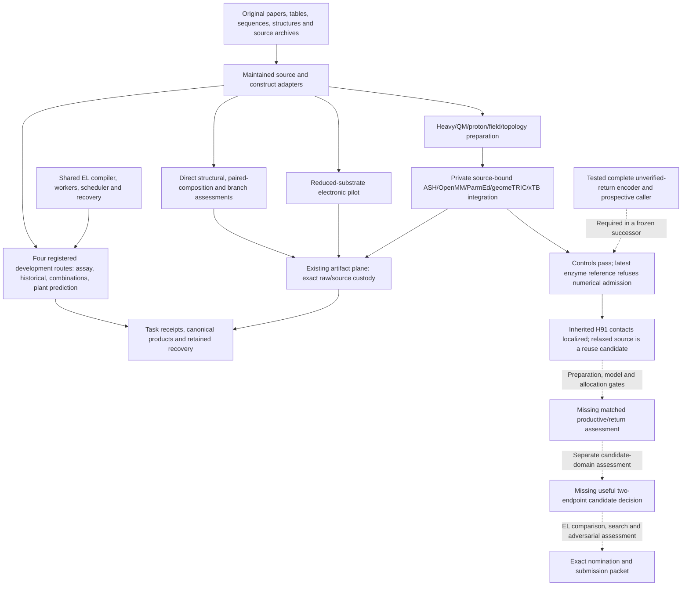

# Rubisco implementation and results in Empirical Lawhood

SPDX-License-Identifier: CC-BY-4.0

This is a retained October 2026 programme checkpoint.
Its scientific evidence and limitations retain their original scope.
Earlier work ordering, active-process descriptions and release gates below describe that checkpoint.
They are not current execution instructions or requirements for the software release.
Use the [workflow catalogue](../../../../docs/reference/workflows.md) and [release procedure](../../../../docs/release/release-artifacts.md) for supported operations.

## Availability of historical procedures

The historical plans named by these reports are not distributed prerequisites.
The [programme contract](programme-contract.md) and [LOOP target contract](loop-target-contract.md) state the public scientific requirements.
The [extension procedure](../../../../docs/development/extending-the-engine.md) and [release procedure](../../../../docs/release/release-artifacts.md) govern current software work.
Historical selections and their original outcomes remain unchanged.

| Preserved document | Available reading and limit |
|---|---|
| [Broad programme protocol](rubisco-broad-programme-protocol.md) | The frozen document states its complete roster, four waves and scientific criteria. Its opening work-plan reference records historical direction, not an additional current input. |
| QM/MM native repair protocols [v1](rr-qmmm-native-repair-protocol-v1.md), [v2](rr-qmmm-native-repair-protocol-v2.md), [v3](rr-qmmm-native-repair-protocol-v3.md), [v4](rr-qmmm-native-repair-protocol-v4.md), [v5](rr-qmmm-native-repair-protocol-v5.md), [v6](rr-qmmm-native-repair-protocol-v6.md), [v7](rr-qmmm-native-repair-protocol-v7.md) and [v8](rr-qmmm-native-repair-protocol-v8.md) | Their `RUBISCO.md` references identify an external historical work plan. These frozen protocols and source-bound criteria remain unchanged. They do not authorize a new run. |
| [Heavy-scaffold recovery protocol](rr-scaffold-recovery-protocol-v1.md) | Its command requires the external `rubisco-rr-heavy-scaffold-v1-replay.py` and complete original ancestor packet. Neither is distributed; the command is a historical recipe, not a runnable checkout example. |
| [Retained source panels](source-panels-report.md) | The original normalizer, finalizer, producing-package ZIP and complete source packet are external. The report preserves identities and findings, not a public replay package. |
| [Input inspection](scientific-inputs-report.md), [supplier search](scientific-supplier-search.md), [prediction assessment](prediction-input-assessment.md) and [plant release assessment](plant-release-assessment.md) | Their named inspection scripts and complete local input packets are not distributed. Source registers identify publications and retained bytes without supplying those payloads. |
| [Legacy tooling review](rubisco-legacy-tooling-reuse-review.md) | Donor code and environments require separate access. The [partial preservation inventory](redirection-preservation-v1.md) identifies the exact helpers actually supplied. |

Use the [partial preservation inventory](redirection-preservation-v1.md) to verify its available archive and member index.
It is not the complete scientific evidence packet or donor environment.
No public retrieval route is supplied here for the omitted packets and helpers.
Their absence from this release does not establish loss of the externally retained originals.

## Historical implementation checkpoint

**Historical implementation checkpoint — 11 October 2026.** The user selected
RUBISCO-LOOP (historical plan, retained outside the release) after the local engineering commit and
deferred the whole release gate until Rubisco/battery completion. The
[LOOP target contract](loop-target-contract.md) records the checked official
comparative requirements, selected symbol census and current W1 software
acceptance (69 numerical/join checks with independent source review, then one
258-check frozen public/configuration/workflow invocation). W1's disclosed
conditional software route is complete; it identifies no mutant kinetics.
The same linked contract now records authenticated recovery of the actual
completed Check2 exports and an independent source-only assessment of all
32 chains/77,650 atoms, preserving 456 missing coordinate positions. It also
records the actual-host authentication of 15,171 selected native asset members
and process/storage inspection. Those complete their stated recovery/audit
scope. The subsequent selected locked import-only check returned OpenMM,
PDBFixer, ParmEd, NumPy and SciPy without source mismatches, environment
synchronization or network access; its separate independent review accepts
that engineering scope. Import costs do not measure preparation costs.
Physical preparation, force/backend adequacy, native peak resources and the
mutation-to-function result remain open.
Three subsequent local WT entry controls have retained engineering obstructions,
with no molecular model returned. The first stopped before any parent contact;
the second preserves a BLOCKED/unknown parent contact and an independently
reproduced invocation-serialization failure before molecular-runner construction.
The third recorded a real child start, then failed before its handshake because
eager infrastructure imports required an absent coordinator dependency. Its
parent and launcher UNKNOWN records remain unchanged; all molecular units
remain unentered.
Their exact custody, independent reviews and measured engineering costs are in
the [actual WT entry record](loop-target-contract.md#actual-wt-entry-controls).
No molecular contact is automatically replayed, and RR2/W2 science stays open.
A fourth, separately selected controller passed independent source/environment,
invocation and authority checks and entered the actual selected WT geometry.
Its first native calls have completed custody records; the geometry and both
parameterised models are still in progress and require independent assessment.
The linked entry record retains that execution scope and the full denominator.
The minimal durable chemical/force prerequisite stage now has independent
engineering acceptance: 54 frozen exposed checks, exact native numerical joins
and the full 24-model/96-control census. Its
[acceptance record](loop-target-contract.md#prospective-molecular-numerical-controls)
keeps actual WT admission, native Context controls, NVE, physical qualification
and kinetics open. Existing entered WT04 source and custody remain unchanged.
The prospective NVE stage also has independently accepted engineering evidence:
37 frozen exposed checks and complete 96-case/48-refinement-pair custody and
numerical joins, including exact reported-component energy diagnostics. All
genuine NVE cases remain unentered. Complete total QM/MM Cartesian derivative
and h/h2 controls have 134 frozen affected checks and independent source
acceptance. Their actual eight-atom ethane control requires a separately frozen
97-evaluation native entry and independent original-return assessment. The
[numerical-control record](loop-target-contract.md#prospective-molecular-numerical-controls)
keeps these engineering achievements distinct from native results, physical
chemistry, ensemble adequacy and mutant kinetics.
Its separately accepted absolute-only protocol successor has 38 affected
checks; prospective h=1e-4 Å and both 4e-5 Eh/Å absolute gates have exact zero
relative allowances. The 134-check integrity invocation and 38-check successor
are separate evidence, and neither supplies actual native derivative returns.
An independently assessed PURE support audit of the three curated historical
stocks retains all thirty assay contexts and twenty-one variant outcomes. Only
eight contexts supply both reported target point summaries; twenty lack
active-site turnover and two lack specificity. Six exact source-series ratios
include a cross-species material comparison and repeated variants, so they
cannot stand for six independent mutation effects. Pairing, covariance,
normalization and Gp transfer remain unqualified; no model or joint prediction
was fitted. The [support audit](loop-target-contract.md) records original native
cell evidence, independent assessment and the next calibration requirements.
The refined plan
records the additive RR1 reported-window integrity repair (109 focused checks).
Those are separate software invocations, not a summed gate, fresh qualification
or calibrated biological prediction. Native preparation/sampling and the final
candidate challenge remain separately open. The historical report below
retains its original cutoff and scientific meaning.

**Progress overview: 10 October 2026, Australia/Sydney.** Selected checkout:
`recchain`, HEAD/base `9c670a3127cb652f839e56463758226749b07c73`.
This document synthesizes the implementation and retained results at that checkpoint.
It introduces no new experiment, scientific allocation or phase-completion claim.
The [programme contract](programme-contract.md) records the refined objective adopted on 10 October 2026.
The original forward plans remain historical records. Original frozen experiments retain their
scientific criteria and outcomes. This update does not resume the parked
molecular route or grant a new scientific allocation.

## Reporting provenance

This is a maintained reporting successor to the original U1
`RUBISCO-PROGRESS.md`, not a replacement for its immutable review binding.
The exact original U1 and U2 snapshots are preserved under
`/media/chevre/SEMIOS/empirical-lawhood-recchain/el-root-plan-cleanup-20261010T104602Z/root-before/`:

| Original supplied snapshot | SHA-256 |
|---|---|
| U1 `RUBISCO-PROGRESS.md` | `5dafa18dda31a9e9ba5b306cab571d53995b1cb53a2f8031b51c2caeb9ebd554` |
| U2 `RUBISCO.md` / supplied `RUBISCO(1).md` | `f36f51fb462dff3283d6759ebbc7cb50266d73705212b3f9f915fe15130e0ff2` |

Those hashes describe the archived original bytes. This successor rebases links
and distinguishes the historical phase ledger from current forward planning,
so it has a separate content identity. Historical results, costs, source
exposure and frozen protocols are unchanged.

## Overall result

The Rubisco work has established a substantial research implementation on the
public EL architecture: authentic source interpretation, exact construct
correspondence, four engine-registered development routes, empirical prediction
and rejection screens, reduced electronic calculations, chemically explicit
protein/QM preparation, integration of existing native molecular software, and
retained execution/recovery with adverse outcomes preserved.

Its strongest scientific deliveries so far are source corrections, rejection
of unsupported candidate transfers, bounded failures of particular predictive
representations, conditional constraints on proposed kinetic explanations, and
localization of a real molecular preparation defect. One conventional
combined-edit prediction succeeds at its declared point-decision scope. One
stronger nonlinear empirical model improves aggregate error while failing the
required joint intervention decision. These successes and failures are both
retained.

**There is still no assessed candidate-domain two-endpoint supplier suitable
for nomination, demonstrated consequential EL advantage, strong exact nomination
or completed submission packet.** The latest molecular reference returned one full enzyme
QM/MM evaluation, but its rejected total energy/gradient were not retained
before numerical guards. There is no accepted repaired reference, fresh final
physical gradient, mutant reaction-path result or kinetic prediction.

The subsequent bounded scientific redirection is complete. It identifies the
inherited source of the severe fixed-MM contacts, authenticates existing relaxed
coordinates as a correction candidate, implements tested complete pre-guard
raw-return capture, and preserves a minimal durable handoff. Its disposition
is **PARK native entry on unresolved scientific/preparation/resource gates**.
The earlier user pause was lifted; the current stop follows the gates, not that
historical pause. [Latest bounded result](redirection-result-v1.md).

## Programme objective and completion standard

The intended endpoint is one exact, realizable Rubisco candidate with a defensible
case for **turnover at least equal to maize and specificity at least equal to
Galdieria partita**, concerning the same candidate under compatible proposed
assays. When a nomination is justified, the local candidate track ends in
design/specification and a reproducible submission/test proposition.
Synthesis and biochemical validation follow submission.
They are not pre-submission requirements.

The refined goal, adopted on 10 October 2026, supersedes the previous joint completion definition.
A bounded, interpretable EL method assessment is required.
Positive comparative advantage and an exact nominee are not required for closeout.
Report method, cross-domain reuse, comparison and candidate outcomes separately.
If no comparison was performed, label it not evaluated.
A shortlist, supported negative or unevaluable boundary can complete the bounded study.

The earlier joint advantage-and-nomination requirements still describe the original experiments.
Their unmet gates and negative results remain in the historical ledger below.
The new objective does not retrospectively establish nomination, biological validation or EL superiority.
Historical reference values remain supporting context, not newly certified controls.
The proposed paired assay need not pretend to reproduce unavailable historical preparations.
[Current programme contract](programme-contract.md),
[reference and assay audit](reference-pair-audit.md),
[completed redirection assessment](redirection-result-v1.md).

## Historical ten-phase status

Completed components are distinguished from complete scientific phases.
The original ten-phase roadmap is not an automatic execution queue.

| Phase | Current status | Completed work and remaining criterion |
|---|---|---|
| 1. Select the blocked task and constructive mechanism | **[X] Complete** | Migration/design contracts, historical dispositions and the provisional Productive-cycle joint-edit response question are recorded. This is the declared Phase 1 scope, not a validated response law. |
| 2. Admit the smallest decisive evidence panel | **[ ] Open** | Extensive authentic source admission, construct correction and completed empirical assessments. An adequate candidate-domain joint-response relation and applicable consequential assessment contract remain missing. |
| 3. Build the minimum integrated EL experiment | **[ ] Open** | Four narrow registered routes execute and recover. The consequential supplier and renewed candidate-domain evaluator are absent. |
| 4. Assess the decisive EL capability comparison | **[ ] Open; unexecuted** | No matched consequential EL-versus-competent-conventional experiment has run. Source correction has an available conventional solution. |
| 5. Consolidate migration and public integration | **[ ] Open** | Maintained adapters, component conformance and minimal durable preservation exist. Full selected consolidation/release and an advertised Rubisco workflow are not complete. |
| 6. Extend feedback to the actual candidate domain | **[ ] Open** | Exact site correspondence is available; mutation-sensitive two-endpoint transport and useful candidate feedback are not. |
| 7. Run finite recursive candidate search | **[ ] Open; unexecuted** | No assessed candidate supplier, candidate search or exact ranked nomination has been delivered. |
| 8. Resolve a selected molecular/mechanistic question | **[ ] Open; native route parked** | Electronic, source, construction, control and provenance components complete. Acceptable reactive reference, matched reaction states and an assessed response remain missing. |
| 9. Adversarially assess the strongest nomination | **[ ] Open** | No strong exact nomination has reached the required dossier/assessment. |

Phase 10, freezing and reproducing the submission packet, also remains open.
This [historical phase ledger](#historical-ten-phase-status) records the old
roadmap's reported marks and outstanding criteria. Exact detailed exit criteria
remain in the archived U2 snapshot identified above; the refined plan owns
current forward planning. Historical R00–R11/M0/M1 labels are different
scientific identities and must not be treated as these phase numbers.

## Implemented architecture and integration

The shared engine supplies the recursive authoring/compiler, process workers,
scheduler, custody, receipts and recovery. Rubisco primarily adds native science
adapters and method bindings. It does not introduce a new generic scientific
scheduler or relax issue, execution, reveal or source-authority boundaries.
Campaign lineage, scientific run plan and executable task graph remain distinct.

Solid arrows show implemented paths or retained work; dashed arrows are
prospective dependencies. Publication custody is a different claim from
execution through registered task receipts.

| Owner | Implemented responsibility |
|---|---|
| [Physical Rubisco adapters](../../../../src/empirical_lawhood/adapters/physical/rubisco_kinetics) | Bounded original-source decoding, lexical Decimal quantities, full row/construct censuses, source identities, heavy/chemical preparation, embedding, Amber nonbonded and reference-topology interpretation. |
| [Conditional assay](../../../../src/empirical_lawhood/adapters/simulators/rubisco_assay) and [feedback method](../../../../src/empirical_lawhood/adapters/methods/rubisco_feedback) | Supplied-kinetics numerical model, closed-form comparison, commitment and bounded feedback. |
| [Historical method](../../../../src/empirical_lawhood/adapters/methods/rubisco_historical) | Source-bound two-fold fitting/prediction, global commitment and exposed assessment. |
| [Combination method](../../../../src/empirical_lawhood/adapters/methods/rubisco_combinations) | Exact paired-subunit joins, conventional three-corner forecast and target assessment. |
| [Prediction methods](../../../../src/empirical_lawhood/adapters/methods/rubisco_prediction) | Natural-only fitting, exact query recipes and parent anchoring; maintained direct structural and paired-response numerical owners. |
| [Electronic/simulator adapters](../../../../src/empirical_lawhood/adapters/simulators/rubisco_electronic) | Cold electronic/source interpretation, explicit optional execution, xTB input/gradient contracts, strict coupled callback and pure unverified-return encoding. |
| Existing infrastructure/API/composition | Bounded I/O, genuine artifact-plane custody, explicit services and generated operation bindings. Kernel scientific records and inward import direction remain respected. |

Four development routes are registered: conditional assay; historical source →
two fit/predict folds → commitment → evaluation; Wilson combinations; and plant
prediction. Their completed task counts are respectively one numerical assay
task, seven historical tasks, four combination tasks and three prediction tasks.
The assay's declared native-effect slots refer to its numerical model, not an
independent biochemical experiment. Structural, paired-composition, electronic,
branch and native QM/MM studies are direct components, with their own raw-plane
custody and **no registered scientific task receipts**.

There is no Rubisco-specific public CLI/workflow entry in the current
[workflow index](../../../../docs/reference/workflows.md). Full native orchestration is still in
explicitly bound private helpers, principally under `/tmp`; it is not a public
reaction-path or kinetic-supplier implementation. At the 10 October review, the
Rubisco adapter directories, inquiry documentation and root Rubisco tests were
untracked. Generated composition aggregates were working-tree integrations.
The later source checkpoint preserves these components without changing their
historical producing identities. Actual producing archives bind dirty-source
bytes; the checkpoint commit does not replace those bindings.
[Architecture state](architecture-state.md),
[platform architecture](../../../../docs/development/architecture.md).

## Migration, prior work and source reuse

The [migration manifest](migration-manifest.json) selects
twelve legacy files: eight adaptations, three conditional molecular selections
and one retained historical plan. Its detailed selectors cover 78 legacy
functions/records, 45 legacy tests and six documentary sections,
with partial and unported dispositions. Reuse comes from the parent's
`icf-yolo` branches/worktrees rather than recreating their numerical methods,
source interpretation or installed native software.

Historical M0 retained 25 energy/force queries on one spinach preparation,
without dynamics, mutation contrast or rates. M1 v1 timed out all six
preparations; v2/v3 had operational interruptions; v4 stopped on scratch
resources without a durable full checkpoint. M1 v5 completed six preparations
and recovered three receipts/seven outputs, using 0.5 ps warmup and 0.2 ps
observation. These are preparation/cost observations, not equilibrium or
mutation-to-kinetics evidence. M1 v6's implementation/specification does not
supply its proposed 18-case sensitivity result. The CPU/OpenCL benchmark,
molecular ablation and M2 predictive bridge remain unentered.
[Historical result register](retained-results.md).

The newer Rr work reuses the authentic parent Amber core, original topology and
archived preparation lineage, A9/B9 Asn donor geometry, and the existing
ASH/OpenMM/ParmEd/geomeTRIC/xTB stack. It has not rerun the old MD to obtain
those inputs. Subsequent evidence distinguishes the parent's pre-relaxation
and relaxed coordinate stages; their different scientific uses require
different selected identities.

## Source, construct and measurement findings

Source intake is a major completed component. It preserves exact original bytes,
native quantity/error tokens, missing/censored outcomes, complete denominators,
construct recipes and incompatible preparation views.

| Source family | Admitted material and important result |
|---|---|
| RR2018 | All nine native rows retained, with source-bound selections/exclusions and exact WT/M100T/D206E endpoints. The historical worker and separate supplement audit have different declared input scopes. |
| Davidi / de Pins / Flamholz | Original and corrected Davidi views remain separate. Corrected `S_val` denotes carboxylation efficiency, not specificity. The broader tables retain their full 1,454×30 and 634×28 denominators; quantity admission does not manufacture paired independent assays. |
| McDonald 2025 source | Eight rows, seven joint-complete; missing triple-mutant specificity and raw/cached error or SEM/SD conflicts are explicit. |
| Full plant release, maintained as McDonald 2026 | Exact XML/S4/S5/S8 decoder; twelve biochemical contexts, eleven joint-complete, 55 turnover/39 specificity observations, 949 screened variants and twenty rescreen flags. Direct specificity is available, superseding the earlier abstract-limited interpretation. |
| Iqbal natural training | 183 rows, 132 unique LSU sequences, 86 genera; 165 turnover, 170 specificity and 155 joint rows. Native tobacco V369 sequence differs from the A369 assessment parent. Complete paired assemblies and preparation units are not identified by row counts. |
| Wilson | Nineteen enzymes, including fifteen verified Te recipes and four Se rows. The primary substitution is P415A, correcting P451A compilation prose. Native mean/SE/count roles and deposited constructs are retained. |
| Potato paired-subunit panel | Seven native contexts and four homogeneous reported recipes. pS1→pS3 includes T22S/N55H/K57S/C90A, not an isolated double edit. Mixed/family controls remain unscored; nucleotide-count prose conflicts and endpoint pairing limits are retained. |
| Reactive inputs and Rr structures | Original carbon mechanism inputs, 24 oxygen geometries and two newly declared CO2 guesses; original 9RUB/2RUS and parent Amber sources. Released carbon reaction roles run in the decarboxylation direction, not an already implemented Rr productive-processing path. |
| H287 and D263 source constraints | H287's full nine-page user-supplied PDF yields 21 WT/N/Q endpoint cells. D263 retains its separate six-row WT/E/N/Q/S/A assay and activation controls. Neither supplies an exact common assay-parent preparation by assumption. |

Genuine source custody includes an initial **38-artifact** publication with nine
originals/eighteen typed canonical products, and a separate **18-artifact** plant
publication with four originals/five typed native products. Source acquisition,
artifact publication and experimental execution are separate operations.
[Source panels](source-panels-report.md),
[plant release](plant-release-assessment.md),
[plant custody](plant-source-publication.md),
[paired design audit](paired-subunit-design-audit.md).

The plant bacterial biochemical construct has an A369 LSU; the V369 plant fusion
is a separate assembly. Literal method text also leaves a RuBP concentration/
rate reconstruction conflict. Neither hidden background changes nor a convenient
unit correction can be silently substituted. Published observation counts,
table rows, held sites and solver views are not automatically independent
biological units. A non-significant specificity difference does not establish
equivalence or preservation within a target margin.

## Executed numerical and empirical assessments

### Supplied-kinetics assay and historical assessment

The current conditional-assay design completes **12/12 numerical queries**, with
identical authenticated read and execution recovery and no new contact. It uses
activated enzyme, saturating RuBP, clamped gases and a specified 298.15 K
stationary model. It computes consequences of supplied kinetics; it does not
predict how a protein edit changes those kinetics. Initial fixed-probe rank
and rank after later feedback remain different claims. Earlier launcher and
historical-claim validation refusals are preserved.

The source-bound historical route completes **seven tasks and six forecasts**:
two mutant folds × three baseline methods. All methods predict WT turnover
13.1 s^-1 and specificity 12.3. M100T's observed 10.6/11.7 fails the historical
10%/3% point-error gates; D206E's 14.1/12.1 passes. This is baseline degeneracy
and two exposed table contrasts, not calibrated coverage, general predictive
accuracy or candidate joint improvement. A model-specific rank-one obstruction
does not prove universal impossibility. [Execution report](execution-report.md).

### Conventional paired-edit success

The Wilson four-task route forecasts the selected combined target from three
measured corners using the frozen multiplicative rule. Forecast turnover/
specificity is **8.16231884/46.08365019**, versus observed **8.1/45.5**.
Relative errors are **0.77%/1.28%**, compared with **14.81%/15.60%** for
parent/no-change. It correctly predicts increased turnover and decreased
specificity, rejecting joint improvement.

This useful conventional success is one exposed, post hoc selected quartet.
Three corners do not identify unrestricted interactions or cross-background
transfer. It establishes no unavailable conventional capability or EL advantage.
[Combination result](combination-result.md).

### Natural-sequence plant prediction

Parent/no-change, fixed 1NN and genus-selected KNN all return the measured parent
for every focal mutant and the separate A369V diagnostic. Mutant sequences and
distance vectors genuinely change, but neighbour membership and raw fitted
means do not. Natural-only tuning selects k=5 for turnover and k=9 for
specificity, with five/eleven actual neighbours after boundary ties.

The completed three-task run retains **60 forecasts/errors and twelve summaries**.
All forecasts equal **3.4958333333333331 s^-1 / 79.707999999999998** after
parent anchoring. Equal-six-site mean absolute log errors are
**0.093546/0.013638**. The measured T391I turnover gain of **28.63%** is missed.
This closes that particular neighbour supplier as mutation-insensitive on this
panel; it does not establish that empirical prediction generally fails.
[Plant prediction result](plant-prediction-result.md).

### Structural-score rejection screen

The direct screen evaluates nine alleles in six held-site folds, retaining
**576 small fits, 90 forecasts/errors, twenty summaries and forty ordering records**.
The primary inverse-folding-plus-conservation model produces varying forecasts,
but all primary endpoint contrasts are negative and favourable turnover is missed.

| Equal-site mean absolute log-contrast error | Turnover | Specificity |
|---|---:|---:|
| Parent/no-change | 0.093546 | 0.013638 |
| Training-only mean response | **0.089269** | **0.012166** |
| Primary inverse-folding + conservation | 0.105342 | 0.012438 |
| IF-only ablation | 0.101029 | 0.012473 |
| Conservation-only ablation | 0.096689 | 0.012703 |

The primary improves specificity over no-change but loses to the training mean
on both endpoints. Neither ablation rescues the complete criterion. This is a
negative assessment of transferred structural/evolutionary proxies, not a
general rejection of physical modelling. [Structural result](plant-structural-screen-result.md).

### Paired-composition assessment

The direct pilot trains on fourteen Wilson mutants in two connected edit blocks
and evaluates the three potato contrasts pS2/pS3/pST against their own pS1
parent. It retains **50 fits, thirty forecasts/errors, ten summaries and thirty
pair orders**, with complete recipes and no potato labels entering fitting.

| Mean absolute log-contrast error | Turnover | Specificity |
|---|---:|---:|
| Parent/no-change | 0.179048 | 0.078354 |
| Training-only equal-block mean | 0.232441 | 0.076447 |
| Primary split-channel ridge | 0.359405 | 0.218364 |
| Pooled-channel ridge ablation | 0.412818 | 0.120449 |
| Anchored RBF conventional comparator | **0.157196** | **0.072221** |

**RBF passes both aggregate error checks.** It nevertheless predicts a
specificity decline for the observed joint-gain pS3 case, and exactly ties pS3
and pST specificity at retained float64 precision. Therefore it fails the
complete useful-delivery criterion, which also requires the favourable and
trade-off decisions. The far-field kernel diagnostic explains this fit's tie;
it is not a kinetic mechanism or arbitrary-precision impossibility theorem.

Every Wilson SSU edit accompanies P415A, so SSU main effects and their LSU
interactions are aliased. Position-blind composition and this exposed transport
test cannot identify a native-WT SSU effect or assess G. partita I95M.
[Paired-composition result](paired-composition-result.md).

## Candidate correspondence and kinetic identifiability

The proposed tobacco V369A and T391I transfers make **no G. partita edit**:
the inspected corresponding residues are already A and I. Structural
correspondence supports **SSU I95M** as the analogous-site hypothesis for Te
V98M; literal F98M is unsupported. Sequence alignment remains ambiguous and
the adverse untrimmed structural fit is retained.

Te V98M is measured on the P415A background: 9.5/56.3 versus its parent's
6.9/52.6. Shared alanine at one corresponding LSU site and backbone proximity
do not make the full red-algal background equivalent. I95M is an exact site
hypothesis, **not a supported kinetic nomination**. No maize-level turnover,
specificity-preservation margin or red-parent transport follows.
[Candidate correspondence](candidate-correspondence-assessment.md).

Several analytical constraints prevent unsupported shortcuts:

- A common activated/reactive fraction multiplying both productive gas channels
  cancels from specificity. Redistribution among states can change specificity
  only with applicable state-specific discrimination and occupation/exchange
  operands; it does not automatically cancel.
- Faster performance of one serial step changes total turnover as
  `1/(1-f+f/r)` only under that cycle model and a supplied waiting fraction f.
  Unknown f permits zero improvement. The illustrative 1.6→5.46 s^-1 target
  would require at least 70.7% removable cycle time even with unlimited step
  acceleration; those values are not a newly authenticated matched assay.
- Ground-state energy, HOMO weight, antagonist exchange and fitted endpoint
  Eyring transforms are not independently supplied mutation-sensitive rate
  operands. Repeated surrogate queries create no new biochemical evidence.

[Cycle assessment](cycle-model-assessment.md),
[productive-cycle question](productive-cycle-question-v1.md),
[coupled assessment design](rr-coupled-assessment-design.md).

## Reactive-input, electronic and conditional branch results

The actual released carbon archive is admitted with its complete census:
**112 members/91 regular files**. Coordinate joins establish that its native
R/TS/P sequence is decarboxylation, with a bonded carboxylated R and separated
CO2 P. It retains source defects such as a product Mg token `M1`, title/alias
conflicts and unmatched environment/input roles; it is not a turnkey matched
Rr forward-processing solver. No original carbon simulation was executed by
this source inspection.

The maintained FM23 preparation projects **24 oxygen geometries/5,994 atoms**,
passing **35/35 oxygen reference checks**. Both explicitly new **249-atom CO2
poses fail three native carbon scaffold checks**. All source and failed geometry
checks remain retained: successful projection of oxygen inputs cannot stand
in for a relaxed carbon encounter or commensurate carbon/oxygen rate model.
[Reactive preparation result](reactive-preparation-result.md).

The reduced-substrate PySCF pilot completes **8/8 fixed-geometry SCF jobs**:
two tautomer geometries under each of two functional/basis realizations, with
anion singlet and vertical neutral doublet calculations. All four primary
Löwdin carbon-ordering tests and all eight site-change directions pass; the
secondary Mulliken interpretation retains those signs.

Primary C2 frontier weights rise **3.02528-fold/3.27463-fold** from state 2 to
state 3. Vertical ionization decreases by **0.005572086/0.007364132 Ha**.
The B-family anion HOMOs are positive, retaining a finite-basis gas-anion
limitation. Different population partitions are not quantitative reproduction
of the original Hirshfeld-I observable. Neither partition, functional family
nor convergence establishes an enzyme reaction rate or protein edit effect.
Full orbital/density/electron/spin/assessment replay uses retained operands
without new SCF. [Electronic result](enolate-electronic-result-v2.md).

The subsequent native-free branch calculation retains four descriptor pairs,
**96 branch points, twelve boundaries and sixteen conditional turnover points**.
The hypothetical specificity grid has **41 positive and 55 negative** outcomes;
these are unweighted illustrative points, not probabilities. At every selected
zero-driving-energy baseline, specificity declines under the unchanged
non-ionization correction. Unknown reorganization/driving energy and waiting
fraction leave the enzyme consequence **UNIDENTIFIED**.

Both primary carbon proxies are below the illustrative 3.4125 turnover factor
even at f=1; a secondary partition permits a larger upper bound. This retains
descriptor sensitivity instead of choosing the favourable view. The result
quantifies why increased local carbon weight alone does not deliver both targets.
[Branch result](branch-sensitivity-result-v3.md).

## Protein, chemical and embedding preparation

The cold Rr heavy-scaffold owner admits exact CIF/PDB/FASTA bytes and 7,044
native atom joins. Actual modeled reference/D263N/H287N projections retain
**7,028/7,022/7,018 native heavy atoms**, respectively, with full removed,
omitted and required-new-atom lists. An original closure failure and retained
recovery remain separate; recovery adds no construction.
[Heavy-scaffold result](rr-scaffold-result-v1.md).

The authentic parent pre-relaxation core has **13,828 atoms/13,994 bonds**, with
7,028 exact translated native heavy joins, eighteen modeled heavy atoms and
sixteen native omissions. Its 44-file source packet binds the whole original
42-member archive. Deposited residue 91 is Asp; the computational reference
models P04718 His91. This construct choice is explicit, and no exact kinetic
WT identity is inferred. The whole topology/archive remain external inputs.
[Amber core source](rr-amber-core-source.md).

Six initial contexts are constructed: reference/D263N/H287N × two declared
enolate–KCX proton views. Native Asn donors, persistent physical proton
identities, phosphate-containing inventories and five boundary caps are explicit.
Both LSUs carry the selected mutation. Reference/D263N/H287N QM inventories
have **81/83/78 atoms**, formal charges **−6/−5/−6** and **382/382/370 electrons**.
Independent replay verifies **6/6 chemical inventories**, but **all six initial
geometries are unready**, failing the unchanged C2–C3/planarity screen. The
reported C2–C3 distance and plane maximum are
**1.605930571351076 Å/1.2794033695745035 Å**.
No geometry-ready native job follows from successful construction alone.
[Initial-geometry result](rr-coupled-initial-geometry-result-v1.md).

The embedding owner derives complete reference/D263N/H287N fields with
**13,752/13,754/13,749 members**, conserving original charge-token arithmetic
and five CA redistributions. Zero-charge members remain in the denominator.
The shared hybrid-minus-nominal offset is approximately **−0.50709849 e**:
a capped-fragment approximation, not roundoff or a globally corrected charge.
Fields are identical between proton views within genotype. These are charge
construction facts, not validation of a reactive Hamiltonian.
[Embedding design](rr-coupled-embedding-design.md).

## Electrostatic-only native repair: controls pass, enzyme route fails

The existing xTB implementation is integrated through cold input, field,
fixing, convergence and gradient contracts. The exact admitted executable
reports xTB 6.7.1 with its retained build identity; a version label alone is
not a source-equivalence claim.

| Retained stage | Actual outcome |
|---|---|
| RF control attempt | Fifteen assigned controls pass, one fixed-position control refuses and one remains unentered. Sixteen scientific processes run. Fixed H1 moves 0.01847245 Å, violating the unchanged 1e−10 Å criterion. |
| Existing L-ANC control successor | Seventeen/seventeen pass in seventeen scientific processes, including exact fixed H1 and a fresh free-H2 gradient 5.444443e−5 Eh/Bohr below 3e−4. |
| Six-case caller v2 | Six pre-exec inherited resource-limit refusals; zero executed workers/xTB processes. Planned/conservative charges are retained separately from actual child CPU. |
| Separately frozen six-case v3 | Six workers and six native optimizations actually execute; all six fail scientific geometry criteria, and all six fresh final gradients remain unentered. Three native exits are zero despite failed scientific screens; three exit 128 with fatal traces. |

Failed iterates show all 31 anchors out of tolerance in every case, mobile
motions **2.287–6.230 Å**, local-plane failures and one-to-three severe contacts.
The reference contains a **0.00785770 Å QM/MM overlap**. Missing QM–MM
repulsion and fixing/model issues motivate a different supported coupling;
more iterations or weaker geometry screens would not establish readiness.
The selected electrostatic-only route stops without accepted enzyme geometry
or kinetics. Across its controls and enzyme run, **39 scientific xTB processes**
are distinct from two metadata probes and later QM/MM calls.
[Control v1](rr-xtb-native-controls-result-v1.md),
[control v2](rr-xtb-native-controls-result-v2.md),
[caller refusal](rr-xtb-native-repair-result-v2.md),
[six-case result](rr-xtb-native-repair-result-v3.md).

## QM/MM integration and authentic reference history

Maintained cold owners admit the complete original Amber LJ/type/exclusion/
signed 1–4 source tables, exact physical/QM/fixed/donor projections and strict
source-bound xTB gradient inputs. Existing ASH/OpenMM/ParmEd/geomeTRIC supplies
native science; integration and custody are explicitly selected private callers.
Disabled zero scaling tokens stay distinct from positive enabled divisors.
Unit conversion, full point-charge membership and boundary masking are retained.
The selected reference has **76 real QM atoms plus five link atoms, fifty
active physical atoms and 13,778 fixed atoms**. These are distinct denominators:
the accepted full physical gradient would have 13,828 rows.

The v1/v2 operational refusals, v3 raw-callback run, v4 total-coupled witness
and v5 conformance successor are different scopes. Early arithmetic/raw-gradient
success did not supply the missing total witness or acceptable optimizer setup.
The later **v5 controls pass total-coupled finite differences, constrained
optimization and full-field capacity**. Those are numerical consistency/control
results, not a validated enzyme model. Subsequent authentic source/context
intake returns, while the v8 enzyme constructor stops in dry selection on
source-table preservation before an enzyme objective.
[Operational refusals](rr-qmmm-operational-refusals-v1-v2.md),
[v3](rr-qmmm-native-coupling-result-v3.md),
[v4](rr-qmmm-native-coupling-result-v4.md),
[v5](rr-qmmm-native-coupling-result-v5.md),
[v6/v7](rr-qmmm-native-coupling-results-v6-v7.md),
[v8](rr-qmmm-native-coupling-result-v8.md).

| Native-coupling development attempt | Retained advance or refusal |
|---|---|
| v1 | Source admission refuses before native physics. |
| v2 | Classical C1 passes; C2 refuses on list/tuple construction. |
| v3 | Nine raw quantum returns are retained; optimizer/report handling refuses. No complete coupled finite-difference witness is supplied by this attempt. |
| v4 | The first retained complete coupled finite-difference witness passes; C3 reservation encounters a source guard before xTB. |
| v5 | Constrained synthetic optimization, fresh gradient and full-field capacity pass. Authentic Amber intake refuses inactive zero scaling tokens. |
| v6 | Corrected authentic source intake passes; a coupled decoder call refuses. |
| v7 | Source/context intake passes; the ordinary construction manifest exceeds its size bound. |
| v8 | A chunked construction plan is retained; native dry selection refuses source-table preservation. |

These eight attempts establish development conformance and diagnose integration
failures; none evaluates the authentic enzyme objective. Their version labels
are distinct from the six-case repair and retained-reference version families.

Authentic native preparation then preserves all original tables through strip,
donor splice, remake, save and reload. Its v2 packet has **70 files/30,680,511
bytes and eleven genuine publications**. The saved derived topology is
5,967,591 bytes, with independent atom/LJ and reload witnesses. No energy,
force Context or kinetic consequence is supplied by this preparation check.
[Preparation result](rr-qmmm-preparation-conformance-result-v2.md).

| Authentic retained-reference attempt | Completed work and stopping point |
|---|---|
| v1 | One saved-topology load and one coupling attempt; native table-LJ force guard refuses before any Context, objective, xTB process or optimizer. 23 publications/120 files/52,856,053 bytes. |
| v2 | One native constructor returns with complete source-table and before/after mask witnesses. Oversized indented construction-audit serialization refuses before C4 or any objective. 23 publications/126 files/73,543,622 bytes. |
| v3/v3b freeze | Complete 7,333,500-byte compact audit retained. C4 passes. One enzyme Context, xTB callback, MM method and full coupled method return; the assessor then refuses a finite/bounded operand. Optimizer refused; fresh gradient unentered. 25 publications/177 files/89,852,484 bytes. |

C4 uses **one Reference Context and three energy/force returns**. Maximum
scaled analytic error is approximately **2.63e−16**, scaled finite-difference error
**2.17e−11**, within the frozen criteria. The enzyme xTB primitive is separately
finite, with energy **−153.00135347343 Eh** and 67 SCC cycles. That primitive
does not establish the finiteness or physical acceptability of the total return.

The v3 assessor applied numerical guards before retaining the complete rejected
total energy/13,828-row gradient. Consequently **energy versus gradient and
nonfinite versus finite over-cap remain unidentified**. Zero accepted full
physical returns is not zero native returns. Independent closure and scientific
audits retain their own checker refusals: required custody checks pass, but the
extended checker is not an unqualified all-checks pass. Its unexecuted following
gradient parse is separately supplied by the numerical audit.
[Reference v1](rr-qmmm-retained-reference-result-v1.md),
[reference v2](rr-qmmm-retained-reference-result-v2.md),
[reference v3](rr-qmmm-retained-reference-result-v3.md).

## Latest scientific redirection and source diagnosis

The review resets the immediate milestone to a useful discrimination connected
to an intervention decision. R0 defines a possible source-domain carbon-adduct
forward/return test; R1 investigates three explicit provenance explanations;
R2 preserves useful components and returns one feasibility disposition.

The complete R1 joins verify all **13,828 dry atoms out of 116,767 source atoms**,
all **7,028 deposited native heavy joins**, source/derived/observed exclusions
and the critical actual force-table/type entries. The contact search represents
**95,599,878 unordered dry-core pairs**, applies complete exclusions and retains
zero-LJ contacts. It does not inspect only the three reported pairs.

| Provenance explanation | Result |
|---|---|
| Inherited H91 completion / pre-relaxation stage | Supported: the severe contacts predate EL derivation and occur after completion of modeled H91. |
| EL atom-index/coordinate mapping creates the contacts | Refuted for this complete contact denominator by exact original/core joins and unchanged contact coordinates. |
| H287 donor/chain reconstruction creates the contacts | Refuted for this denominator; all three contacts predate the splice and none involves the three moved physical protons. |

The original/held HID91 coordinates have three nonexcluded contacts below
0.75 Å, at **0.097095/0.278487/0.652370 Å**. All are fixed MM outside the QM/
active region. The alternate unrelaxed HIE91 source has four severe contacts.
Authentic archived relaxed HID91 and HIE91 each have **zero**. The three HID
distances become approximately **3.943661/3.523245/2.628707 Å**, respectively.

This supplies an existing, already-paid geometry correction candidate. It
requires consistent full-dry source mapping, environment/reactive proton/cap
construction and new preparation identity, rather than patching three atoms.
The archived solvated PME/H-bond-constrained minimization has no retained
stationarity/force certificate. Its geometry does not automatically qualify
the dry reactive Hamiltonian or resolve the computational-H91/assay-WT identity.
Large source-pair repulsion makes the v3 refusal plausible but cannot recover
or identify the missing actual rejected total operands.

The sealed ordinary diagnosis retains **35 files/282,226 bytes**, all four
software checker refusals and their corrected checks, and **14.68 measured
diagnostic-process CPU seconds**, with reading/closure tails explicitly unknown.
It creates no native Context, solver call or artifact-plane authority.
[Decision](redirection-decision-v1.md),
[redirection result](redirection-result-v1.md).

### Complete pre-guard raw-return implementation

The new pure [coupled-return encoder](../../../../src/empirical_lawhood/adapters/simulators/rubisco_electronic/coupled_return.py)
preserves complete energy and whole-system gradient before numerical admission,
including nonfinite/over-cap/malformed values, NumPy dtype/endian/logical value
bytes, ordered atom/element joins, source/input/protocol/assessment digests and
exact unit conventions. Expanded/stored capture ceilings are each **16 MiB**;
the encoder refuses instead of truncating or admitting invalid scientific records.

The private prospective assessment writes both operands before unchanged
physical guards, separating actual native-return, complete-capture, numerical-
acceptance and accepted-full-physical counts. Capture failure prevents admission.
Twenty-three synthetic tests pass, covering the full 13,828×3 gradient through
its last row, nonfinite/over-cap values, shape/size/write failures and caller
counters. Independent source/AST review confirms twelve historical helper
bodies and all scientific thresholds/constants are unchanged. A future freeze
must explicitly bind the new encoder and successor source. **This is tested
prospective software, not a new authentic return or recovery of missing v3 data.**

### Why the mechanism/reference route is parked

H287 CKABP processing has WT hydrolysis/decarboxylation ≥0.9 and H287N ≤0.1.
Only under a restricted exclusive-exits/no-recapture/common-prefactor observation
model does this imply at least a ninefold local odds reduction, equivalent to
a ≥**5.4103 kJ/mol** competition-barrier shift at 23°C. The acid-stable numerator
can include terminal misprocessing products such as pyruvate; it is not
automatically productive PGA. Isolated CKABP processing is not automatically
normal gas-adduct commitment.

**D263N has no measured CKABP processing ratio.** Its 6.28→0.82 s^-1 turnover
and 9.2→8.8 specificity do not label commitment unchanged. It is an optional
unlabelled comparator, with separate own-WT, activation and finite-CO2 controls.
The 25°C His6/CABP-normalized D263 assay is not pooled with the 23°C H287 assay.

The smallest proposed later H287 study is own-background WT/H287N × two declared
carbon-adduct proton/water lineages: four competitions and at least eight exit
operands. Productive hydration/scission may require multiple transition states
before a committed basin. D263 adds its own background requirements. This is
not the six existing enolate preparations.

No concrete matched forward-processing/committed-basin construction, complete
observation/prefactor sensitivity scope or relevant physical chemistry comparison
is selected. The complete reference allocation also remains unproven under the
carried parent ceiling. Therefore **no reference successor was frozen or entered
under the resumed conditional scope**. Unchanged completed C4 controls were not
repeated. A complete kinetic map is unnecessary for a first research test, but
its provisional operands and decision consequence must be explicit. Confirming
known H287 damage cannot by itself rank beneficial red-algal/SSU edits.
[H287 panel](h287-kinetic-panel.md),
[coupled assessment](rr-coupled-assessment-design.md),
[current gates](redirection-result-v1.md#why-the-conditional-reference-did-not-enter).

## Verification, custody, costs and preservation

Verification covers different implementation snapshots and scopes. The scientific
review ran **544 focused Rubisco/import/discovery tests in 170.86 seconds**, plus
Ruff, and recomputed 120 structural/paired point errors. It preceded retained-
reference v3 and therefore does not independently verify that later execution.
The later raw-return component has **23 focused tests passing in 1.40 seconds**,
Ruff and independent source review. Earlier 131/172/191/238-test totals overlap
and must not be added or presented as a current full-suite total.

Actual producing archives, receipts, raw files, complete censuses and source
bindings are primary evidence. Successful retained reads recover results
without repeating numerical/native work. Direct artifact publications do not
create task receipts, biological qualification or unseen evidence. All panels
remain exposed; software withholding and a new identifier do not make them
fresh. Operational refusals, failed preparations, unevaluable cases, adverse
points and unknown tails remain part of the record.

| Retained execution scope | Reported CPU / wall seconds | Selected retention / accounting limit |
|---|---:|---|
| Plant KNN preparation/execution/recovery | 123.525453 / 124.036547 | 46,652,596 bytes; broader engineering/acquisition costs separate. |
| Structural direct screen | 13.341332 / 13.499916 | 15,950,788 bytes. |
| Paired-composition direct pilot | 8.549974 / 8.694172 | 13,733,399 bytes. |
| Reduced electronic supervisor | 699.325837 / 319.282016 | Successful packet 51,061,400 bytes; with three zero-SCF refusals, 153,612,862 bytes. |
| Six-case electrostatic repair v3 | 308.85 / 178.81 | 23,594,460-byte packet; 249.879388 worker CPU seconds; separate from later QM/MM subtotal. |
| Authentic retained reference v3 | 59.61 / 58.79 | 89,852,484 bytes; 42.190647 worker / 17.419353 parent CPU seconds. |
| Cumulative QM/MM and source-preserving preparation through v3 | 373.33 outer CPU | 192.266673 worker + 181.063327 parent CPU; 38 selected roots/787,643,240 bytes. |
| Bounded R0–R2 redirection | 1,194.955 observed wall; 1,494.955 conservative charged wall | 223 selected retained engineering files/3,452,454 bytes; not an all-project byte or CPU total. |

These denominators differ and can contain nested work; **the table is not an
additive whole-project cost estimate**. Acquisition, engineering, human review,
refusals, separate audits and unmeasured historical tails cannot be assigned
zero cost. QM/MM carries **34 callback reservations/33 actual xTB processes**;
the older 39 electrostatic xTB processes and eight reduced SCF jobs are separate.
The native cumulative ceilings were not reset: the 200-parent-CPU-second bound
leaves **18.936673 seconds**, with complete successor costs still to demonstrate.
The two closed v3 audits add **33 files/358,300 bytes** outside v3's selected
scientific output denominator.

The minimal durable [preservation handoff](redirection-preservation-v1.md)
is under `programmes/biology/photosynthesis/records/preservation/redirection-v1`: **96 members,
5,705,316 expanded bytes and 1,080,339 stored ZIP bytes**, with complete byte/
SHA256 index and verification. It includes prospective source/tests, the full
provenance study, both v3 audits and selected historical helpers/config/profile.
It is a partial source/metadata package, not a portable native replay environment.

Bulk primary evidence remains under
`/tmp/empirical-lawhood-rubisco-20261009/{public-inputs,retained-execution}`;
some original parent inputs remain on `/media/chevre/SEMIOS`. Private helpers,
held contexts, native executable/profile and exact receipt ancestry remain
required dependencies. Temporary storage risk and untracked source state are
explicit. The new overview is a later reporting artifact, outside the sealed
R0–R2 preservation census; it does not rewrite that closure.

The EL electronic profile and the parent's native molecular interpreter are
separate selected environments. Existing locked profiles use `uv run --no-sync`
where applicable; no synchronization is needed to inspect results or edit prose.
[Environment guide](../../../../docs/using/environments.md), [testing guide](../../../../docs/development/testing.md).

## Scientific readout and remaining work

The implemented platform can retain and assess prerequisites, recover results,
reject erroneous source interpretations and expose failed preparations without
losing their history. The research has narrowed which source transfers and
predictive representations are useful at their tested scopes. It has not
demonstrated a constructive EL capability unavailable to competent conventional
methods, an assessed candidate-domain joint-benefit relation or the challenge's
biological endpoint.

Reopening the parked Rr molecular route needs a finite experiment whose outcomes
change a mechanism/intervention choice, with exact source/preparation identity,
matched states and observable, observation assumptions, independent model/
nuisance sensitivities, competent comparisons, complete failure denominator and
an allocation fitting carried costs. Archived relaxed coordinates are a
concrete reuse option, not a reason to continue an operational repair sequence
without that scientific selection.

Using a useful Rr local-processing result in a G. partita nomination rationale
would need separate beneficial/adverse candidate sensitivity and
Form II→red-algal/SSU transport assessment. That molecular transport gate is not
a prerequisite for starting a distinct scoped empirical inquiry under the
adopted refined plan. Wet-lab validation remains post-submission.

The former joint programme required a constructive EL capability and a strong
exact nomination; negative closure did not complete that historical objective.
The adopted current contract permits a supported negative or unevaluable
bounded closeout without a nominee or positive EL advantage, provided the
method, reuse, comparison and candidate dispositions are reported separately.
Failures of the tested baselines do not establish that competent conventional
methods cannot solve the Rubisco problem. Their scoped results and the positive
conventional combination forecast remain unchanged.

## Evidence navigation

- **Scope and current status:** refined Rubisco plan (historical plan, retained outside the release), [programme contract](programme-contract.md), [architecture state](architecture-state.md).
- **Source/candidate foundations:** [source panels](source-panels-report.md), [reference controls](reference-pair-audit.md), [paired design](paired-subunit-design-audit.md), [candidate correspondence](candidate-correspondence-assessment.md).
- **Empirical executions:** [initial registered executions](execution-report.md), [Wilson](combination-result.md), [KNN](plant-prediction-result.md), [structural](plant-structural-screen-result.md), [paired](paired-composition-result.md).
- **Electronic and molecular work:** [reactive preparation](reactive-preparation-result.md), [electronic](enolate-electronic-result-v2.md), [branch](branch-sensitivity-result-v3.md), [six-case native failure](rr-xtb-native-repair-result-v3.md), [QM/MM controls](rr-qmmm-native-coupling-result-v5.md), [authentic native preparation](rr-qmmm-preparation-conformance-result-v2.md), [latest reference](rr-qmmm-retained-reference-result-v3.md).
- **Current disposition and reproducibility:** [redirection decision](redirection-decision-v1.md), [bounded result](redirection-result-v1.md), [preservation inventory](redirection-preservation-v1.md), [exact closure](preservation/redirection-v1/completion.json).
